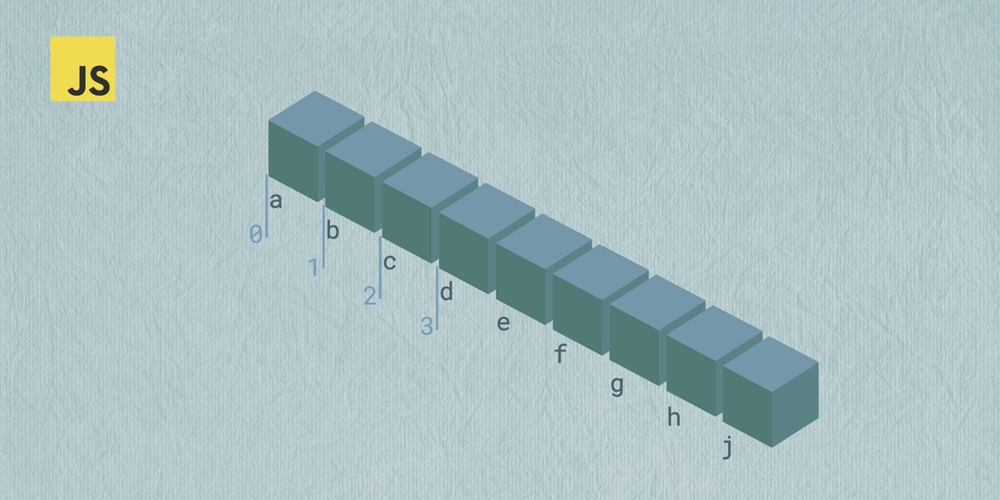

# Лекция 5. Массивы в JavaScript: хранение и обработка данных



## Цели лекции

После этой лекции вы сможете:

- создавать массивы и получать их элементы по индексу;
- безопасно работать с `length`;
- перебирать массивы через `for` и `for...of`;
- добавлять, удалять и заменять элементы;
- отличать методы, которые изменяют исходный массив, от методов, которые создают новый;
- выбирать между `map`, `filter`, `find`, `some`, `every`, `reduce` и `forEach`;
- объединять несколько операций в цепочку;
- обрабатывать пустой массив и ситуацию, когда элемент не найден;
- выносить обработку массива в отдельные функции.

Главная мысль лекции:

> Сначала определите, какой результат хотите получить, и только потом выбирайте способ обработки массива.

## Зачем нужны массивы

До этого мы хранили значения в отдельных переменных:

```javascript
const student1 = "Иван";
const student2 = "Мария";
const student3 = "Петр";
```

Такой подход быстро становится неудобным. Если студентов станет сто, нам понадобится сто переменных. Кроме того, будет сложно вывести всех студентов, найти нужного или посчитать их количество.

Массив позволяет хранить несколько значений в одной переменной:

```javascript
const students = ["Иван", "Мария", "Петр"];
```

Теперь список можно перебирать, фильтровать, изменять и передавать в функцию целиком.

Например, с массивом температур можно выполнить разные операции:

```javascript
const temperatures = [18, 21, 23, 19, 25];
```

- найти среднее значение;
- оставить значения выше `20`;
- преобразовать градусы Цельсия в градусы Фаренгейта;
- найти первое критическое значение.

Массив нужен не только для хранения данных. Он нужен прежде всего для их обработки.

## Что такое массив

Массив - это упорядоченная коллекция значений.

Для создания массива используются квадратные скобки:

```javascript
const cities = ["Prague", "Berlin", "Warsaw"];
```

Массив может быть пустым:

```javascript
const tasks = [];
```

Проверить, является ли значение массивом, можно через `Array.isArray()`:

```javascript
console.log(Array.isArray([])); // true
console.log(Array.isArray("hello")); // false
console.log(Array.isArray(42)); // false
```

Оператор `typeof` для такой проверки не подходит:

```javascript
console.log(typeof []); // "object"
```

Это историческая особенность JavaScript, поэтому для проверки массива используйте `Array.isArray()`.

### Что можно хранить в массиве

JavaScript позволяет хранить в одном массиве значения разных типов:

```javascript
const mixed = ["Иван", 25, true, null];
```

Но в реальных задачах удобнее, когда один массив содержит данные одного назначения:

```javascript
const names = ["Иван", "Мария", "Анна"];
const prices = [100, 250, 80];
const answers = [true, false, true];
```

В следующей лекции мы изучим объекты и начнем хранить в массивах товары, пользователей, задачи и другие сложные сущности.

## Индексы

Каждый элемент массива имеет индекс. Индексация начинается с нуля:

```javascript
// Индекс:          0        1        2
const students = ["Иван", "Мария", "Петр"];
```

Получить элемент можно через квадратные скобки:

```javascript
console.log(students[0]); // "Иван"
console.log(students[1]); // "Мария"
console.log(students[2]); // "Петр"
```

Если такого индекса нет, JavaScript вернет `undefined`:

```javascript
console.log(students[10]); // undefined
```

### Изменение элемента по индексу

Содержимое массива можно изменять:

```javascript
const students = ["Иван", "Мария", "Петр"];

students[1] = "Анна";

console.log(students); // ["Иван", "Анна", "Петр"]
```

Массив объявлен через `const`, но его элементы все равно можно менять. `const` запрещает присвоить переменной другой массив, а не изменять содержимое существующего.

```javascript
const numbers = [1, 2, 3];

numbers[0] = 10; // можно
numbers.push(4); // можно

// numbers = [7, 8, 9]; // ошибка
```

### Не создавайте дырки в массиве

Можно записать значение по индексу, которого еще нет:

```javascript
const numbers = [1, 2, 3];

numbers[5] = 6;

console.log(numbers); // [1, 2, 3, empty x 2, 6]
```

Между существующими значениями появились пустые позиции. Такие массивы сложнее обрабатывать, поэтому новые элементы обычно добавляют специальными методами.

## Свойство `length`

Свойство `length` хранит длину массива:

```javascript
const students = ["Иван", "Мария", "Петр"];

console.log(students.length); // 3
```

Первый индекс равен `0`, поэтому индекс последнего элемента равен `length - 1`:

```javascript
const students = ["Иван", "Мария", "Петр"];

const lastStudent = students[students.length - 1];

console.log(lastStudent); // "Петр"
```

Современный метод `at()` позволяет считать позиции с конца:

```javascript
const students = ["Иван", "Мария", "Петр"];

console.log(students.at(0)); // "Иван"
console.log(students.at(-1)); // "Петр"
console.log(students.at(-2)); // "Мария"
```

Для пустого массива оба способа вернут `undefined`:

```javascript
const items = [];

console.log(items[items.length - 1]); // undefined
console.log(items.at(-1)); // undefined
```

## Перебор массива

Обычно недостаточно сохранить данные. Нужно пройти по элементам и выполнить с ними действия.

Например:

- вывести все значения;
- посчитать сумму;
- найти подходящий элемент;
- изменить каждый элемент;
- посчитать количество элементов по условию.

Начнем с циклов, которые уже изучали на предыдущих лекциях.

### Перебор через `for`

Цикл `for` удобен, когда нужен индекс:

```javascript
const students = ["Иван", "Мария", "Петр"];

for (let index = 0; index < students.length; index++) {
  console.log(`Индекс: ${index}, студент: ${students[index]}`);
}
```

Важное условие:

```javascript
index < students.length
```

Если написать `<=`, цикл сделает лишнюю итерацию:

```javascript
const numbers = [10, 20, 30];

for (let index = 0; index <= numbers.length; index++) {
  console.log(numbers[index]);
}

// 10
// 20
// 30
// undefined
```

`for` удобно использовать, когда нужно:

- получить индекс;
- изменить элемент по индексу;
- идти с конца массива;
- изменить шаг;
- остановить цикл через `break`;
- пропустить итерацию через `continue`.

Пример изменения элементов:

```javascript
const numbers = [1, 2, 3, 4];

for (let index = 0; index < numbers.length; index++) {
  numbers[index] = numbers[index] * 2;
}

console.log(numbers); // [2, 4, 6, 8]
```

Этот код изменяет исходный массив.

### Перебор через `for...of`

Если индекс не нужен, можно получать сразу значение:

```javascript
const students = ["Иван", "Мария", "Петр"];

for (const student of students) {
  console.log(student);
}
```

`for...of` удобно использовать, когда:

- нужен только текущий элемент;
- не нужно изменять элементы по индексам;
- нужен простой и читаемый перебор;
- может понадобиться `break` или `continue`.

### Массив как аргумент функции

Обработку массива лучше оформлять отдельной функцией:

```javascript
function getSum(numbers) {
  let sum = 0;

  for (const number of numbers) {
    sum += number;
  }

  return sum;
}

console.log(getSum([10, 20, 30])); // 60
console.log(getSum([])); // 0
```

Функция получает массив, выполняет одну понятную задачу и возвращает результат.

## Добавление и удаление элементов

Для работы с началом и концом массива используются четыре метода:

| Метод | Действие | Что возвращает |
|---|---|---|
| `push` | добавляет в конец | новую длину |
| `pop` | удаляет с конца | удаленный элемент |
| `unshift` | добавляет в начало | новую длину |
| `shift` | удаляет из начала | удаленный элемент |

Все четыре метода изменяют исходный массив.

### `push`

```javascript
const students = ["Иван", "Мария"];

const newLength = students.push("Петр", "Анна");

console.log(students); // ["Иван", "Мария", "Петр", "Анна"]
console.log(newLength); // 4
```

### `pop`

```javascript
const students = ["Иван", "Мария", "Петр"];

const removedStudent = students.pop();

console.log(removedStudent); // "Петр"
console.log(students); // ["Иван", "Мария"]
```

Если массив пустой, `pop()` вернет `undefined`:

```javascript
const items = [];

console.log(items.pop()); // undefined
```

### `unshift`

```javascript
const students = ["Иван", "Мария"];

const newLength = students.unshift("Анна");

console.log(students); // ["Анна", "Иван", "Мария"]
console.log(newLength); // 3
```

### `shift`

```javascript
const students = ["Иван", "Мария", "Петр"];

const removedStudent = students.shift();

console.log(removedStudent); // "Иван"
console.log(students); // ["Мария", "Петр"]
```

### Стек и очередь

Стек работает по принципу LIFO: последний добавленный элемент извлекается первым.

```javascript
const history = [];

history.push("page-1");
history.push("page-2");

console.log(history.pop()); // "page-2"
```

Очередь работает по принципу FIFO: первый добавленный элемент извлекается первым.

```javascript
const queue = [];

queue.push("first");
queue.push("second");

console.log(queue.shift()); // "first"
```

На больших массивах `shift` и `unshift` могут работать медленнее, потому что после операции меняются индексы остальных элементов. Для небольших учебных задач это не является проблемой.

## `slice` и `splice`

Названия методов похожи, но поведение принципиально отличается.

| Метод | Изменяет исходный массив | Что возвращает |
|---|---:|---|
| `slice` | нет | новый массив |
| `splice` | да | массив удаленных элементов |

### `slice`

`slice(start, end)` копирует часть массива. Индекс `start` включается, индекс `end` не включается.

```javascript
const numbers = [10, 20, 30, 40, 50];

const part = numbers.slice(1, 4);

console.log(part); // [20, 30, 40]
console.log(numbers); // [10, 20, 30, 40, 50]
```

Если `end` не указан, копирование продолжается до конца:

```javascript
const numbers = [10, 20, 30, 40, 50];

console.log(numbers.slice(2)); // [30, 40, 50]
```

Отрицательные индексы позволяют считать с конца:

```javascript
const numbers = [10, 20, 30, 40, 50];

console.log(numbers.slice(-2)); // [40, 50]
```

Вызов без аргументов создает копию массива:

```javascript
const numbers = [10, 20, 30];
const copy = numbers.slice();

console.log(copy); // [10, 20, 30]
console.log(copy === numbers); // false
```

### `splice`

`splice(start, deleteCount, ...items)` может удалять, добавлять и заменять элементы.

Удаление:

```javascript
const letters = ["a", "b", "c", "d"];

const removed = letters.splice(1, 2);

console.log(removed); // ["b", "c"]
console.log(letters); // ["a", "d"]
```

Добавление:

```javascript
const letters = ["a", "d"];

letters.splice(1, 0, "b", "c");

console.log(letters); // ["a", "b", "c", "d"]
```

Замена:

```javascript
const letters = ["a", "b", "c"];

const removed = letters.splice(1, 1, "x");

console.log(removed); // ["b"]
console.log(letters); // ["a", "x", "c"]
```

Перед использованием `splice` задайте себе вопрос:

> Действительно ли я хочу изменить исходный массив?

## Callback-функции в методах массива

Многие методы массива получают функцию, которую вызывают для каждого элемента. Такая функция называется callback.

Можно передать обычную именованную функцию:

```javascript
function double(number) {
  return number * 2;
}

const numbers = [1, 2, 3];
const doubled = numbers.map(double);

console.log(doubled); // [2, 4, 6]
```

Или записать callback на месте:

```javascript
const numbers = [1, 2, 3];

const doubled = numbers.map((number) => {
  return number * 2;
});
```

Короткая запись стрелочной функции:

```javascript
const doubled = numbers.map((number) => number * 2);
```

Callback может получать три аргумента:

```javascript
array.method((element, index, array) => {
  // element - текущий элемент
  // index - индекс текущего элемента
  // array - исходный массив
});
```

Обычно нужен только `element`. Не добавляйте остальные параметры без необходимости.

## Проверка наличия через `includes`

`includes` проверяет, содержит ли массив указанное значение, и возвращает `true` или `false`:

```javascript
const roles = ["user", "admin", "editor"];

console.log(roles.includes("admin")); // true
console.log(roles.includes("owner")); // false
```

`includes` подходит для поиска конкретного значения. Если нужно искать по условию, используйте `find` или `some`.

## `map` - преобразование элементов

`map` создает новый массив, применяя callback к каждому элементу.

```javascript
const prices = [100, 200, 300];

const discountedPrices = prices.map((price) => price * 0.9);

console.log(discountedPrices); // [90, 180, 270]
console.log(prices); // [100, 200, 300]
```

Основные свойства `map`:

- возвращает новый массив;
- не изменяет исходный массив;
- обычно сохраняет количество элементов;
- использует значение, которое вернул callback.

Частая ошибка - забыть `return`:

```javascript
const numbers = [1, 2, 3];

const squares = numbers.map((number) => {
  number * number;
});

console.log(squares); // [undefined, undefined, undefined]
```

Исправление:

```javascript
const squares = numbers.map((number) => {
  return number * number;
});
```

Или короткая запись:

```javascript
const squares = numbers.map((number) => number * number);
```

## `filter` - отбор элементов

`filter` создает новый массив только из элементов, для которых callback вернул `true`.

```javascript
const numbers = [3, 10, 7, 20, 15, 2];

const bigNumbers = numbers.filter((number) => number > 10);

console.log(bigNumbers); // [20, 15]
console.log(numbers); // [3, 10, 7, 20, 15, 2]
```

Если ни один элемент не подходит, `filter` возвращает пустой массив:

```javascript
const numbers = [1, 2, 3];

const result = numbers.filter((number) => number > 100);

console.log(result); // []
```

Пустой массив является корректным результатом, а не ошибкой.

## `find` - поиск первого элемента

`find` возвращает первый элемент, для которого callback вернул `true`:

```javascript
const numbers = [5, 12, 8, 130, 44];

const firstBigNumber = numbers.find((number) => number > 10);

console.log(firstBigNumber); // 12
```

`find` останавливает поиск после первого совпадения. Если ничего не найдено, результатом будет `undefined`:

```javascript
const numbers = [1, 3, 5];

const firstEven = numbers.find((number) => number % 2 === 0);

console.log(firstEven); // undefined
```

Результат нужно проверять:

```javascript
if (firstEven === undefined) {
  console.log("Подходящий элемент не найден");
} else {
  console.log(`Найдено число: ${firstEven}`);
}
```

## `some` - есть ли хотя бы один

`some` возвращает `true`, если хотя бы один элемент соответствует условию:

```javascript
const temperatures = [18, 21, 37, 22];

const hasCriticalTemperature = temperatures.some(
  (temperature) => temperature > 35
);

console.log(hasCriticalTemperature); // true
```

Если массив пустой, `some` возвращает `false`:

```javascript
console.log([].some((item) => item > 0)); // false
```

## `every` - соответствуют ли все элементы

`every` возвращает `true`, если все элементы соответствуют условию:

```javascript
const numbers = [10, 20, 30];

const allPositive = numbers.every((number) => number > 0);

console.log(allPositive); // true
```

Важная особенность:

```javascript
console.log([].every((item) => item > 0)); // true
```

В пустом массиве нет элемента, который нарушает условие. Это логически корректное поведение, но его нужно учитывать в задачах.

## `reduce` - получение одного результата

`reduce` используют, когда из массива нужно получить одно итоговое значение.

Сначала вспомним решение через цикл:

```javascript
const numbers = [10, 20, 30];
let sum = 0;

for (const number of numbers) {
  sum += number;
}

console.log(sum); // 60
```

Та же задача через `reduce`:

```javascript
const numbers = [10, 20, 30];

const sum = numbers.reduce((accumulator, current) => {
  return accumulator + current;
}, 0);

console.log(sum); // 60
```

Здесь:

- `accumulator` - результат предыдущего шага;
- `current` - текущий элемент;
- `0` - начальное значение аккумулятора.

Пошагово:

```text
Начало: accumulator = 0
Шаг 1: 0 + 10 = 10
Шаг 2: 10 + 20 = 30
Шаг 3: 30 + 30 = 60
Результат: 60
```

Указывайте начальное значение явно:

```javascript
const sum = [].reduce((accumulator, current) => {
  return accumulator + current;
}, 0);

console.log(sum); // 0
```

Без начального значения вызов `reduce` на пустом массиве завершится ошибкой.

`reduce` подходит не только для суммы. Например, можно посчитать количество положительных чисел:

```javascript
const numbers = [-2, 4, 0, 7, -1, 5];

const positiveCount = numbers.reduce((count, number) => {
  if (number > 0) {
    return count + 1;
  }

  return count;
}, 0);

console.log(positiveCount); // 3
```

Но не нужно использовать `reduce` для любой задачи. Если обычный цикл читается проще, цикл является хорошим решением.

## `forEach` - действие для каждого элемента

`forEach` вызывает callback для каждого элемента и всегда возвращает `undefined`.

```javascript
const numbers = [10, 20, 30];

numbers.forEach((number, index) => {
  console.log(`Индекс: ${index}, значение: ${number}`);
});
```

`forEach` подходит, когда нужен побочный эффект:

- вывести значение;
- записать лог;
- изменить внешнее состояние;
- позже создать DOM-элемент для каждого значения.

`forEach` не подходит для создания нового массива:

```javascript
const numbers = [1, 2, 3];

const result = numbers.forEach((number) => number * 2);

console.log(result); // undefined
```

Если нужен новый массив, используйте `map`.

`forEach`, `map` и `filter` не поддерживают `break`. Если нужен ручной досрочный выход, используйте цикл. Если нужен первый подходящий элемент, используйте `find`.

## Как выбрать способ обработки массива

Перед написанием кода определите форму результата.

| Задача | Подходящий инструмент |
|---|---|
| нужен индекс или полный контроль | `for` |
| нужен последовательный перебор значений | `for...of` |
| проверить наличие конкретного значения | `includes` |
| получить новый массив той же длины | `map` |
| оставить часть элементов | `filter` |
| получить первый подходящий элемент | `find` |
| проверить, есть ли хотя бы один | `some` |
| проверить, соответствуют ли все | `every` |
| получить один итог | `reduce` |
| выполнить действие без результата | `forEach` |
| изменить структуру массива | `push`, `pop`, `shift`, `unshift`, `splice` |

### Цепочка методов

Методы, которые возвращают массив, можно объединять в цепочку:

```javascript
const numbers = [1, 3, 4, 6, 7, 8, 10, 11];

const result = numbers
  .filter((number) => number % 2 === 0)
  .map((number) => number * 5)
  .reduce((sum, number) => sum + number, 0);

console.log(result); // 140
```

Разберем промежуточные результаты:

```javascript
// filter: [4, 6, 8, 10]
// map: [20, 30, 40, 50]
// reduce: 140
```

Порядок методов влияет на результат:

```javascript
const numbers = [5, 12, 8, 20, 3];

const firstResult = numbers
  .filter((number) => number > 5)
  .map((number) => number * 2);

const secondResult = numbers
  .map((number) => number * 2)
  .filter((number) => number > 5);

console.log(firstResult); // [24, 16, 40]
console.log(secondResult); // [10, 24, 16, 40, 6]
```

Не стремитесь собрать всю программу в одну длинную цепочку. Если код сложно читать, разделите шаги на переменные или функции.

## Частые ошибки

### Выход за границы массива

```javascript
for (let index = 0; index <= numbers.length; index++) {
  // лишняя итерация
}
```

Правильно:

```javascript
for (let index = 0; index < numbers.length; index++) {
  // ...
}
```

### Ожидание массива от `forEach`

```javascript
const result = numbers.forEach((number) => number * 2);

console.log(result); // undefined
```

Для преобразования нужен `map`.

### Забытый `return`

```javascript
const result = numbers.map((number) => {
  number * 2;
});
```

При фигурных скобках результат нужно вернуть явно.

### Путаница между `find` и `filter`

```javascript
const numbers = [5, 12, 8, 20];

console.log(numbers.find((number) => number > 10));
// 12

console.log(numbers.filter((number) => number > 10));
// [12, 20]
```

### Использование результата `find` без проверки

```javascript
const result = numbers.find((number) => number > 1000);

console.log(result * 2); // NaN
```

Сначала проверьте, найден ли элемент.

### Неожиданное изменение исходного массива

```javascript
const letters = ["a", "b", "c"];

letters.splice(1, 1);

console.log(letters); // ["a", "c"]
```

Перед вызовом метода проверьте, изменяет ли он исходный массив.

## Заключение

Массив - это структура данных для хранения и обработки упорядоченного набора значений.

Главные выводы:

1. Индексы начинаются с нуля.
2. Последний индекс равен `length - 1`.
3. Циклы дают полный контроль над перебором.
4. Некоторые методы изменяют исходный массив, а некоторые создают новый результат.
5. Метод выбирают по форме необходимого результата.
6. `find` может вернуть `undefined`.
7. Для `reduce` лучше явно задавать начальное значение.
8. Сложную обработку лучше разделять на функции и понятные шаги.

### Краткий чек-лист

После лекции проверьте себя:

- могу получить первый и последний элемент;
- понимаю разницу между `for` и `for...of`;
- знаю, какие методы изменяют массив;
- могу выбрать между `map`, `filter`, `find` и `reduce`;
- понимаю назначение `some` и `every`;
- проверяю результат `find`;
- могу объяснить каждый шаг цепочки методов;
- умею обработать пустой массив.

## Практика

Практика состоит из трех частей:

1. короткие проверки понимания;
2. независимые задачи на обработку данных;
3. исправление ошибок в готовом коде.

### Часть 1. Короткие задачи

#### Задача 1. Первый и последний элемент

```javascript
const cities = ["Prague", "Berlin", "Warsaw", "Vienna"];
```

Выведите:

- первый город;
- последний город через `length`;
- последний город через `at()`;
- длину массива.

#### Задача 2. Перебор

```javascript
const values = [15, 20, 25, 30];
```

Выведите каждое значение вместе с его индексом. Затем посчитайте сумму через `for...of`.

#### Задача 3. Изменение массива

```javascript
const queue = ["second", "third"];
```

Получите массив:

```javascript
["first", "second", "third", "fourth"]
```

Затем извлеките первый элемент очереди и сохраните его в отдельную переменную.

#### Задача 4. `slice` и `splice`

```javascript
const letters = ["a", "b", "c", "d", "e"];
```

1. Создайте новый массив из элементов `"b"`, `"c"`, `"d"`, не изменяя исходный.
2. Удалите из исходного массива `"b"` и `"c"`.
3. Выведите исходный массив, копию и удаленные элементы.

### Часть 2. Независимые сценарии

#### Сценарий 1. Контроль багажа

```javascript
const baggageWeights = [12, 25, 8, 31, 19, 23, 27];
```

Требования:

1. Получите все значения тяжелее `23` кг.
2. Найдите первое значение тяжелее `25` кг.
3. Проверьте, есть ли багаж тяжелее `30` кг.
4. Проверьте, весь ли багаж весит не меньше `5` кг.
5. Посчитайте общий вес.
6. Создайте массив доплат. Каждый килограмм сверх `23` кг стоит `15` евро. Если превышения нет, доплата равна `0`.
7. Исходный массив не должен измениться.

Ожидаемые отдельные результаты:

```javascript
[25, 31, 27]
31
true
true
145
[0, 30, 0, 120, 0, 0, 60]
```

Оформите каждую операцию отдельной функцией.

#### Сценарий 2. Модерация сообщений

```javascript
const messages = [
  "  Hello everyone  ",
  "",
  "BUY SPAM NOW",
  "JavaScript is great",
  "   ",
  "This is an advertisement",
];
```

Требования:

1. Создайте новый массив без пробелов в начале и конце строк.
2. Исключите пустые сообщения.
3. Исключите сообщения со словами `spam` и `advertisement` без учета регистра.
4. Создайте массив длин оставшихся сообщений.
5. Найдите первое сообщение длиннее `15` символов.
6. Проверьте, осталось ли хотя бы одно сообщение.
7. Исходный массив не должен измениться.

Не записывайте всю обработку в один callback. Разделите решение на понятные шаги.

#### Сценарий 3. Показания датчиков

```javascript
const readings = [18, 21, -100, 24, 37, 22, 999, 19];
```

Корректное показание находится в диапазоне от `-50` до `50` включительно.

Требования:

1. Получите только корректные показания.
2. Найдите первое показание выше `30`.
3. Проверьте, есть ли среди корректных показаний отрицательное.
4. Проверьте, все ли корректные показания не превышают `50`.
5. Создайте массив значений в градусах Фаренгейта по формуле `F = C * 1.8 + 32`.
6. Посчитайте среднее корректное значение.
7. Продумайте результат функции среднего значения для пустого массива.

### Часть 3. Debugging

Сначала предскажите результат, затем найдите проблему и исправьте код.

#### Ошибка 1. Результат `forEach`

```javascript
const prices = [100, 200, 300];

const discounted = prices.forEach((price) => {
  return price * 0.9;
});

console.log(discounted);
```

#### Ошибка 2. Забытый `return`

```javascript
const numbers = [1, 2, 3];

const squares = numbers.map((number) => {
  number * number;
});

console.log(squares);
```

#### Ошибка 3. Граница цикла

```javascript
const numbers = [10, 20, 30];

for (let index = 0; index <= numbers.length; index++) {
  console.log(numbers[index]);
}
```

#### Ошибка 4. Элемент не найден

```javascript
const numbers = [5, 10, 15];
const result = numbers.find((number) => number > 100);

console.log(result * 2);
```

#### Ошибка 5. Исходный массив изменился

```javascript
const original = ["a", "b", "c", "d"];
const selected = original.splice(1, 2);

console.log(original);
console.log(selected);
```

Измените решение так, чтобы получить `"b"` и `"c"`, не изменяя `original`.

## Домашняя работа

> Общие условия:
>
> - Используйте `const` для объявления массивов.
> - Выводите результаты через `console.log()`.
> - Не изменяйте исходный массив, если это прямо не требуется в условии.
> - В задачах с функциями проверяйте минимум два разных набора данных.

1. Создайте массив:

   ```javascript
   const cities = ["Prague", "Berlin", "Warsaw", "Vienna"];
   ```

   Выведите:

   - первый город;
   - третий город;
   - последний город через `length - 1`;
   - последний город через `at()`;
   - длину массива.

2. Создайте массив:

   ```javascript
   const names = ["Ivan", "Maria", "Petr"];
   ```

   Выполните следующие действия:

   - добавьте в конец `"Anna"` и `"Olga"`;
   - удалите последний элемент и сохраните его в переменную `removedName`;
   - выведите удаленное имя, итоговый массив и его длину.

3. Создайте очередь:

   ```javascript
   const queue = ["second", "third"];
   ```

   Выполните следующие действия:

   - добавьте `"first"` в начало;
   - добавьте `"fourth"` в конец;
   - извлеките первый элемент и сохраните его в переменную;
   - выведите извлеченный элемент и итоговую очередь.

4. Создайте массив:

   ```javascript
   const numbers = [10, 20, 30, 40, 50, 60];
   ```

   Не изменяя исходный массив, создайте:

   - массив из первых трех элементов;
   - массив из последних двух элементов;
   - массив из элементов с индексами от `1` до `4`, не включая индекс `4`.

   Выведите все результаты и исходный массив.

5. Создайте массив:

   ```javascript
   const letters = ["a", "b", "c", "d", "e"];
   ```

   С помощью `splice`:

   - удалите `"b"` и `"c"`;
   - сохраните удаленные элементы в отдельную переменную;
   - вставьте на их место `"x"` и `"y"`;
   - выведите удаленные элементы и итоговый массив.

6. Напишите функцию `getEvenNumbers(numbers)`, которая принимает массив чисел и возвращает новый массив только с четными числами.

   Проверьте функцию:

   ```javascript
   getEvenNumbers([1, 2, 3, 4, 5, 6]);
   getEvenNumbers([1, 3, 5]);
   getEvenNumbers([]);
   ```

7. Напишите функцию `applyDiscount(prices, discountPercent)`, которая возвращает новый массив цен со скидкой.

   Требования:

   - исходный массив не изменяется;
   - процент скидки передается вторым аргументом;
   - итоговые цены округляются до двух знаков после запятой.

   Пример:

   ```javascript
   applyDiscount([100, 250, 80, 120], 10);
   // [90, 225, 72, 108]
   ```

8. Напишите функцию `findFirstLongWord(words, minLength)`, которая возвращает первое слово длиннее `minLength`.

   Если подходящего слова нет, функция должна вернуть строку `"Not found"`.

   Проверьте оба сценария:

   ```javascript
   findFirstLongWord(["cat", "elephant", "dog"], 5);
   findFirstLongWord(["cat", "dog"], 10);
   ```

9. Создайте массив:

   ```javascript
   const scores = [78, 92, 67, 84, 59];
   ```

   Определите:

   - есть ли хотя бы одна оценка от `90`;
   - все ли оценки не меньше `50`;
   - содержит ли массив оценку `84`.

   Для каждой проверки выведите отдельный результат.

10. Напишите функцию `getAverage(numbers)`, которая возвращает среднее арифметическое чисел.

    Требования:

    - сумму посчитайте через `reduce`;
    - для пустого массива функция должна вернуть `null`;
    - исходный массив не изменяется.

    Проверьте функцию:

    ```javascript
    getAverage([10, 20, 30]);
    getAverage([5]);
    getAverage([]);
    ```

11. Создайте массив показаний:

    ```javascript
    const readings = [18, 21, -100, 24, 37, 22, 999, 19];
    ```

    Выполните последовательную обработку:

    - оставьте значения от `-50` до `50` включительно;
    - преобразуйте корректные значения из градусов Цельсия в градусы Фаренгейта по формуле `F = C * 1.8 + 32`;
    - найдите сумму полученных значений;
    - исходный массив не изменяйте.

12. Создайте массив:

    ```javascript
    const numbers = [1, 3, 4, 6, 7, 8, 10, 11];
    ```

    Выполните задачу одной цепочкой методов:

    - оставьте только четные числа;
    - умножьте каждое число на `5`;
    - найдите сумму результата;
    - выведите промежуточные результаты отдельно и итоговую сумму.

13. Напишите функцию `reverseArray(values)`, которая создает новый массив в обратном порядке.

    Условия:

    - не используйте метод `reverse`;
    - не изменяйте исходный массив;
    - сначала решите через цикл и `push`;
    - дополнительно попробуйте решить через `reduce`.

14. Напишите функцию `analyzeNumbers(numbers)`, которая отдельно выводит или возвращает следующие результаты:

    - количество положительных чисел;
    - первое отрицательное число;
    - наличие нуля;
    - новый массив квадратов всех чисел;
    - сумму всех чисел.

    Проверьте функцию на обычном и пустом массиве:

    ```javascript
    analyzeNumbers([-3, 0, 4, 7, -1, 5]);
    analyzeNumbers([]);
    ```
