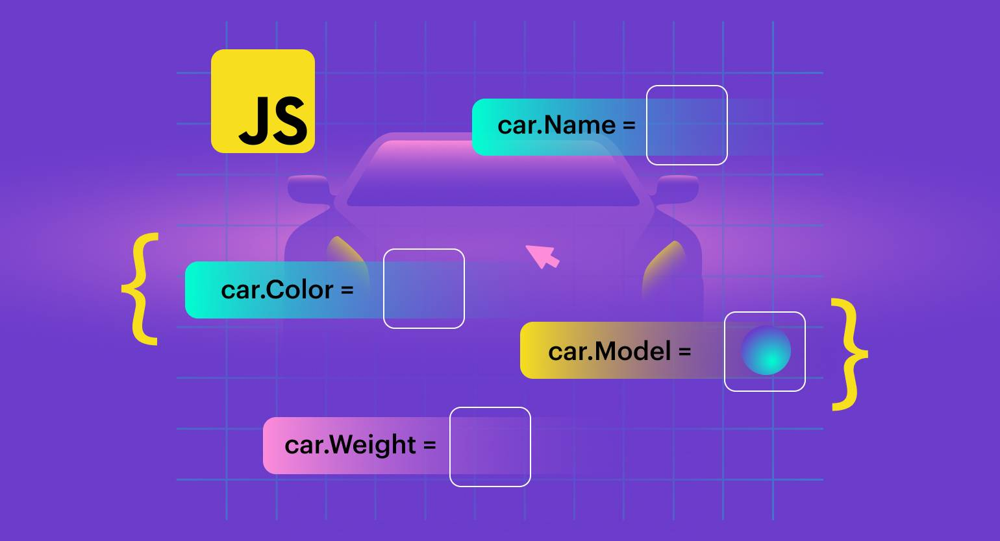

# Лекция 6. Объекты в JavaScript: структура данных, ссылки и массивы объектов



## Цели лекции

После этой лекции вы сможете:

- создавать объекты и получать их свойства;
- выбирать между точкой и квадратными скобками;
- добавлять, изменять и удалять свойства;
- создавать методы и использовать `this`;
- безопасно работать с вложенными объектами;
- проверять наличие свойств;
- перебирать ключи и значения объекта;
- понимать разницу между ссылкой и копией;
- использовать деструктуризацию, spread и rest;
- обрабатывать массивы объектов методами из лекции 5;
- обновлять данные без изменения исходного объекта.

Главная мысль лекции:

> Объект объединяет связанные данные под понятными именами, а массив хранит упорядоченный список значений.

## Зачем нужны объекты

Массив хорошо подходит для упорядоченного списка:

```javascript
const temperatures = [18, 21, 23, 19];
```

Но хранить информацию о конкретной сущности в массиве неудобно:

```javascript
const user = ["Ivan", 25, "Prague", true];
```

Чтобы прочитать такие данные, нужно помнить значение каждого индекса:

```javascript
console.log(user[0]); // имя
console.log(user[1]); // возраст
console.log(user[2]); // город
```

Объект позволяет обращаться к данным по понятным именам:

```javascript
const user = {
  name: "Ivan",
  age: 25,
  city: "Prague",
  isActive: true,
};
```

```javascript
console.log(user.name); // "Ivan"
console.log(user.city); // "Prague"
```

Полезно запомнить:

```text
Массив отвечает на вопрос: в каком порядке находятся значения?
Объект отвечает на вопрос: какое значение хранится в конкретном свойстве?
```

Объекты используются для описания:

- пользователей;
- товаров;
- задач;
- настроек;
- сообщений;
- ответов API;
- конфигурации приложения.

## Создание объекта

Объект создается с помощью фигурных скобок `{}`:

```javascript
const product = {
  id: 1,
  title: "Laptop",
  price: 1200,
  inStock: true,
};
```

Каждая запись внутри объекта состоит из ключа и значения:

```text
ключ: значение
```

В объекте `product`:

- `title` является ключом;
- `"Laptop"` является значением;
- `title: "Laptop"` является свойством.

Пустой объект:

```javascript
const settings = {};
```

### Сокращенная запись свойств

Если имя переменной совпадает с именем свойства, запись можно сократить:

```javascript
const name = "Maria";
const age = 30;

const user = {
  name,
  age,
};

console.log(user); // { name: "Maria", age: 30 }
```

Полная запись выглядела бы так:

```javascript
const user = {
  name: name,
  age: age,
};
```

Сокращенная запись постоянно встречается при создании объектов из данных формы и переменных.

## Доступ к свойствам

Есть два основных способа получить свойство:

- через точку;
- через квадратные скобки.

### Доступ через точку

Точка используется, когда имя свойства известно заранее:

```javascript
const user = {
  name: "Ivan",
  age: 25,
};

console.log(user.name); // "Ivan"
console.log(user.age); // 25
```

### Доступ через квадратные скобки

Квадратные скобки используются, когда ключ хранится в переменной:

```javascript
const user = {
  name: "Ivan",
  age: 25,
};

const key = "name";

console.log(user[key]); // "Ivan"
console.log(user.key); // undefined
```

`user.key` ищет свойство с буквальным именем `key`. `user[key]` сначала получает значение переменной `key`, а затем использует его как имя свойства.

Квадратные скобки также нужны для ключей с пробелами или специальными символами:

```javascript
const settings = {
  "dark-mode": true,
  "font size": 16,
};

console.log(settings["dark-mode"]); // true
console.log(settings["font size"]); // 16
```

Если свойства нет, результатом будет `undefined`:

```javascript
console.log(user.email); // undefined
```

### Вычисляемые ключи

Имя свойства можно определить во время создания объекта:

```javascript
const settingName = "theme";

const settings = {
  [settingName]: "dark",
};

console.log(settings); // { theme: "dark" }
```

Это полезно, когда ключ приходит из формы, настройки или другого источника данных.

## Добавление, изменение и удаление свойств

Объекты в JavaScript можно изменять после создания.

### Добавление

```javascript
const user = {
  name: "Ivan",
};

user.age = 25;
user["city"] = "Prague";

console.log(user);
// { name: "Ivan", age: 25, city: "Prague" }
```

### Изменение

```javascript
const user = {
  name: "Ivan",
  age: 25,
};

user.age = 26;

console.log(user.age); // 26
```

### Удаление

```javascript
const user = {
  name: "Ivan",
  age: 25,
  temporaryCode: "abc",
};

delete user.temporaryCode;

console.log(user);
// { name: "Ivan", age: 25 }
```

### Объект и `const`

`const` запрещает присвоить переменной другой объект, но не запрещает менять существующий:

```javascript
const user = {
  name: "Ivan",
};

user.name = "Maria"; // можно
user.age = 30; // можно

// user = { name: "Petr" }; // ошибка
```

Позже мы сравним изменение существующего объекта и создание нового объекта с обновленными данными.

## Методы объекта и `this`

Значением свойства может быть функция. Такая функция называется методом объекта.

```javascript
const user = {
  name: "Ivan",

  sayHello() {
    console.log("Hello!");
  },
};

user.sayHello(); // "Hello!"
```

Метод может работать с другими свойствами этого объекта через `this`:

```javascript
const user = {
  name: "Ivan",
  age: 25,

  getInfo() {
    return `${this.name}, ${this.age}`;
  },
};

console.log(user.getInfo()); // "Ivan, 25"
```

В вызове:

```javascript
user.getInfo();
```

значением `this` будет объект слева от точки, то есть `user`.

### Почему не стоит обращаться к объекту по имени внутри метода

```javascript
const user = {
  name: "Ivan",

  getName() {
    return user.name;
  },
};
```

Метод жестко связан с переменной `user`. Вариант с `this` гибче:

```javascript
function getName() {
  return this.name;
}

const user = {
  name: "Ivan",
  getName,
};

const admin = {
  name: "Maria",
  getName,
};

console.log(user.getName()); // "Ivan"
console.log(admin.getName()); // "Maria"
```

### Стрелочная функция и `this`

Если методу нужен `this`, используйте обычную функцию или короткую запись метода:

```javascript
const user = {
  name: "Ivan",

  sayName() {
    console.log(this.name);
  },
};
```

Стрелочная функция не получает собственный `this`:

```javascript
const user = {
  name: "Ivan",

  sayName: () => {
    console.log(this.name);
  },
};
```

В этом примере `this` не будет ссылаться на `user`. Подробные правила контекста вызова будут разобраны позже.

## Вложенные объекты

Значением свойства может быть другой объект:

```javascript
const user = {
  name: "Ivan",
  address: {
    city: "Prague",
    zip: "11000",
  },
};
```

Доступ к вложенному свойству:

```javascript
console.log(user.address.city); // "Prague"
```

Уровней вложенности может быть несколько:

```javascript
const order = {
  id: 101,
  customer: {
    name: "Maria",
    contacts: {
      email: "maria@example.com",
    },
  },
};

console.log(order.customer.contacts.email);
```

Слишком глубокая вложенность усложняет код, поэтому структуру данных нужно проектировать осознанно.

## Безопасный доступ через optional chaining

Если промежуточного свойства нет, обычный доступ вызовет ошибку:

```javascript
const user = {
  name: "Ivan",
};

// console.log(user.address.city);
// TypeError: Cannot read properties of undefined
```

Optional chaining `?.` безопасно остановит чтение и вернет `undefined`:

```javascript
console.log(user.address?.city); // undefined
```

Для нескольких уровней проверяйте каждый потенциально отсутствующий уровень:

```javascript
const email = order.customer?.contacts?.email;
```

Безопасный вызов метода:

```javascript
user.sayHello?.();
```

Если метода нет, ошибка не возникнет.

### Значение по умолчанию через `??`

Optional chaining часто используют вместе с оператором `??`:

```javascript
const city = user.address?.city ?? "Unknown";

console.log(city); // "Unknown"
```

`??` использует правое значение только тогда, когда левое равно `null` или `undefined`:

```javascript
console.log(0 ?? 10); // 0
console.log(false ?? true); // false
console.log("" ?? "Default"); // ""
console.log(undefined ?? "Default"); // "Default"
```

Это отличается от `||`, который считает `0`, `false` и пустую строку falsy-значениями.

## Проверка наличия свойства

Проверка через `undefined` не всегда показывает, существует ли ключ:

```javascript
const user = {
  age: undefined,
};

console.log(user.age === undefined); // true
```

Свойство `age` существует, но его значение равно `undefined`.

### Оператор `in`

```javascript
console.log("age" in user); // true
console.log("name" in user); // false
```

`in` проверяет объект и его цепочку прототипов.

### `Object.hasOwn()`

Если нужно проверить только собственное свойство объекта, используйте `Object.hasOwn()`:

```javascript
const user = {
  name: "Ivan",
};

console.log(Object.hasOwn(user, "name")); // true
console.log(Object.hasOwn(user, "toString")); // false
```

Прототипы подробно будут разобраны в лекции 10.

## Перебор свойств объекта

Объект нельзя перебирать через `for...of` напрямую. Сначала его свойства нужно превратить в массив или использовать `for...in`.

### `for...in`

```javascript
const user = {
  name: "Ivan",
  age: 25,
  city: "Prague",
};

for (const key in user) {
  if (Object.hasOwn(user, key)) {
    console.log(`${key}: ${user[key]}`);
  }
}
```

Проверка `Object.hasOwn()` исключает унаследованные свойства.

### `Object.keys()`

Возвращает массив собственных ключей:

```javascript
const keys = Object.keys(user);

console.log(keys); // ["name", "age", "city"]
```

### `Object.values()`

Возвращает массив значений:

```javascript
const values = Object.values(user);

console.log(values); // ["Ivan", 25, "Prague"]
```

### `Object.entries()`

Возвращает массив пар `[key, value]`:

```javascript
const entries = Object.entries(user);

console.log(entries);
// [["name", "Ivan"], ["age", 25], ["city", "Prague"]]
```

Удобный перебор через деструктуризацию:

```javascript
for (const [key, value] of Object.entries(user)) {
  console.log(`${key}: ${value}`);
}
```

После `Object.keys`, `Object.values` или `Object.entries` можно использовать методы массивов из лекции 5.

## Ссылки и сравнение объектов

Переменная хранит ссылку на объект. При присваивании объекта в другую переменную копируется ссылка, а не сам объект.

```javascript
const original = {
  name: "Ivan",
  age: 25,
};

const reference = original;

reference.age = 30;

console.log(original.age); // 30
console.log(reference.age); // 30
```

Обе переменные указывают на один объект.

### Сравнение объектов

Объекты сравниваются по ссылке:

```javascript
const first = { name: "Ivan" };
const second = { name: "Ivan" };

console.log(first === second); // false
```

Содержимое выглядит одинаково, но это два разных объекта.

```javascript
const first = { name: "Ivan" };
const second = first;

console.log(first === second); // true
```

Здесь обе переменные содержат одну ссылку.

## Поверхностное копирование

Оператор spread создает новый объект и копирует в него свойства:

```javascript
const original = {
  name: "Ivan",
  age: 25,
};

const copy = { ...original };

copy.age = 30;

console.log(original.age); // 25
console.log(copy.age); // 30
console.log(original === copy); // false
```

Альтернативный способ:

```javascript
const copy = Object.assign({}, original);
```

В современном коде для простого копирования чаще используют spread.

### Ограничение поверхностной копии

Spread копирует только первый уровень:

```javascript
const original = {
  name: "Ivan",
  address: {
    city: "Prague",
  },
};

const copy = { ...original };

copy.address.city = "Brno";

console.log(original.address.city); // "Brno"
```

Объекты `original.address` и `copy.address` содержат одну ссылку:

```javascript
console.log(original.address === copy.address); // true
```

### Вложенное копирование

Если известно, какое вложенное свойство нужно обновить, можно скопировать его отдельно:

```javascript
const updated = {
  ...original,
  address: {
    ...original.address,
    city: "Ostrava",
  },
};

console.log(original.address.city); // "Brno"
console.log(updated.address.city); // "Ostrava"
```

Для глубокой копии многих встроенных структур существует `structuredClone()`:

```javascript
const deepCopy = structuredClone(original);
```

Но глубокое копирование не нужно выполнять автоматически в каждой задаче. `structuredClone()` также не копирует функции. Важно сначала понять, какие данные действительно нужно сделать независимыми.

## Деструктуризация объекта

Деструктуризация позволяет получить свойства в отдельные переменные:

```javascript
const user = {
  name: "Ivan",
  age: 25,
  city: "Prague",
};

const { name, age } = user;

console.log(name); // "Ivan"
console.log(age); // 25
```

### Переименование

```javascript
const { name: userName } = user;

console.log(userName); // "Ivan"
```

### Значение по умолчанию

```javascript
const { language = "en" } = user;

console.log(language); // "en"
```

Значение по умолчанию используется только для `undefined`, но не для `null`:

```javascript
const settings = {
  language: null,
};

const { language = "en" } = settings;

console.log(language); // null
```

### Вложенная деструктуризация

```javascript
const product = {
  title: "Laptop",
  meta: {
    category: "electronics",
  },
};

const {
  title,
  meta: { category },
} = product;

console.log(title); // "Laptop"
console.log(category); // "electronics"
```

Вложенная деструктуризация требует, чтобы `meta` существовал. Для неизвестных данных безопаснее сначала проверить структуру или использовать optional chaining.

### Деструктуризация параметров функции

```javascript
function getUserLabel({ name, age }) {
  return `${name}, ${age}`;
}

console.log(getUserLabel(user)); // "Ivan, 25"
```

Такой вариант удобен, если функции нужны только конкретные свойства объекта.

## Spread и rest

Оператор `...` выполняет разные задачи в зависимости от места использования.

### Spread

Spread распаковывает свойства объекта:

```javascript
const user = {
  name: "Ivan",
  age: 25,
};

const userWithCity = {
  ...user,
  city: "Prague",
};
```

### Обновление свойства

```javascript
const updatedUser = {
  ...user,
  age: 26,
};

console.log(user.age); // 25
console.log(updatedUser.age); // 26
```

Порядок имеет значение. Побеждает свойство, которое находится правее:

```javascript
const first = { ...user, age: 30 };
const second = { age: 30, ...user };

console.log(first.age); // 30
console.log(second.age); // 25
```

### Объединение объектов

```javascript
const defaultSettings = {
  theme: "light",
  language: "en",
  notifications: true,
};

const userSettings = {
  theme: "dark",
};

const settings = {
  ...defaultSettings,
  ...userSettings,
};

console.log(settings);
// { theme: "dark", language: "en", notifications: true }
```

### Rest

Rest собирает оставшиеся свойства при деструктуризации:

```javascript
const user = {
  id: 1,
  name: "Ivan",
  age: 25,
  password: "secret",
};

const { password, ...publicUser } = user;

console.log(publicUser);
// { id: 1, name: "Ivan", age: 25 }
```

Этот прием можно использовать, чтобы создать новый объект без конкретного свойства.

## Массивы объектов

В реальных приложениях часто используется массив сущностей:

```javascript
const users = [
  { id: 1, name: "Ivan", age: 25, city: "Prague", isActive: true },
  { id: 2, name: "Maria", age: 30, city: "Brno", isActive: false },
  { id: 3, name: "Petr", age: 28, city: "Prague", isActive: true },
];
```

Методы из лекции 5 теперь работают с объектами.

### Найти один объект

```javascript
const user = users.find((item) => item.id === 2);

console.log(user);
// { id: 2, name: "Maria", ... }
```

Если пользователь не найден, `find` вернет `undefined`:

```javascript
const user = users.find((item) => item.id === 100);

console.log(user?.name ?? "User not found");
```

### Отфильтровать объекты

```javascript
const activeUsers = users.filter((user) => user.isActive);
const pragueUsers = users.filter((user) => user.city === "Prague");
```

### Получить массив отдельных свойств

```javascript
const names = users.map((user) => user.name);

console.log(names); // ["Ivan", "Maria", "Petr"]
```

### Создать обновленные объекты

```javascript
const usersWithLabels = users.map((user) => {
  return {
    ...user,
    label: `${user.name} (${user.city})`,
  };
});
```

Исходные объекты не изменяются, потому что callback возвращает новые объекты.

### Обновить один объект по `id`

```javascript
function updateUserStatus(users, userId, isActive) {
  return users.map((user) => {
    if (user.id !== userId) {
      return user;
    }

    return {
      ...user,
      isActive,
    };
  });
}

const updatedUsers = updateUserStatus(users, 2, true);
```

### Посчитать итог

```javascript
const totalAge = users.reduce((sum, user) => {
  return sum + user.age;
}, 0);

const averageAge = users.length === 0 ? null : totalAge / users.length;
```

Проверка пустого массива защищает от результата `NaN`.

## Объект с вложенными массивами

Данные часто объединяют объекты и массивы:

```javascript
const order = {
  id: 101,
  customer: {
    name: "Maria",
    email: "maria@example.com",
  },
  items: [
    { title: "Keyboard", price: 80, quantity: 1 },
    { title: "Mouse", price: 40, quantity: 2 },
  ],
};
```

Посчитаем сумму заказа:

```javascript
const total = order.items.reduce((sum, item) => {
  return sum + item.price * item.quantity;
}, 0);

console.log(total); // 160
```

Получим названия товаров:

```javascript
const titles = order.items.map((item) => item.title);

console.log(titles); // ["Keyboard", "Mouse"]
```

Так выглядят многие данные из API: один объект содержит информацию о сущности и вложенные списки.

## Частые ошибки

### Точка вместо динамического ключа

```javascript
const key = "name";

console.log(user.key); // ищет свойство "key"
console.log(user[key]); // использует значение переменной
```

### Ссылка вместо копии

```javascript
const copy = original;

copy.age = 30;
```

Так создается вторая ссылка. Для поверхностной копии используйте `{ ...original }`.

### Ожидание глубокой копии от spread

```javascript
const copy = { ...original };
```

Вложенные объекты и массивы продолжают хранить общие ссылки.

### Доступ к отсутствующему вложенному свойству

```javascript
// user.address.city

user.address?.city ?? "Unknown";
```

### Неправильный порядок spread

```javascript
const first = { ...user, age: 30 }; // age равен 30
const second = { age: 30, ...user }; // age взят из user
```

### Изменение объекта внутри `map`

```javascript
const updated = users.map((user) => {
  user.isActive = true;
  return user;
});
```

Этот код изменяет исходные объекты. Безопасный вариант:

```javascript
const updated = users.map((user) => {
  return {
    ...user,
    isActive: true,
  };
});
```

### Среднее значение пустого массива

```javascript
const average = total / users.length;
```

Если массив пустой, результатом будет `NaN`. Сначала проверяйте `length`.

## Заключение

Главные выводы:

1. Объект хранит связанные значения под именованными ключами.
2. Точка используется для известного ключа, квадратные скобки - для динамического.
3. `const` не запрещает менять свойства объекта.
4. `this` в методе зависит от способа вызова функции.
5. Optional chaining защищает доступ к отсутствующим вложенным данным.
6. Объекты сравниваются по ссылке.
7. Spread создает поверхностную копию.
8. Деструктуризация упрощает получение свойств.
9. Методы массивов позволяют обрабатывать списки объектов.
10. Обновление через spread помогает не изменять исходные данные.

### Чек-лист

Проверьте себя:

- могу создать объект и получить его свойства;
- понимаю разницу между `user.key` и `user[key]`;
- умею добавить, изменить и удалить свойство;
- могу написать метод с `this`;
- умею безопасно читать вложенные данные;
- понимаю разницу между ссылкой и копией;
- умею использовать деструктуризацию и spread;
- могу найти, отфильтровать и обновить объекты в массиве;
- учитываю пустой массив и отсутствующие свойства.

## Практика

### Часть 1. Базовые задачи

1. Создайте объект `user` со свойствами `name`, `age` и `city`. Выведите каждое свойство через точку, а затем через квадратные скобки.
2. Создайте объект:

   ```javascript
   const settings = {
     "dark-mode": true,
     "font size": 16,
   };
   ```

   Получите оба значения. Затем используйте переменную `key = "dark-mode"` для динамического доступа.
3. Создайте объект `book` со свойствами `title`, `author` и `year`. Добавьте количество страниц, измените год, удалите автора и выведите результат.
4. Создайте объект `product` со свойствами `title`, `price` и `quantity`. Добавьте метод `getTotal()`, возвращающий `price * quantity`.
5. Получите из объекта `product`:

   - массив ключей;
   - массив значений;
   - массив пар;
   - строки формата `key: value`.
6. Создайте `reference` и `copy` для одного объекта. Измените оба значения и объясните, какое изменение затронуло оригинал.
7. Используйте деструктуризацию, чтобы получить `title` и `price`, переименовать `title` в `productTitle` и задать значение `category = "unknown"` по умолчанию.
8. Создайте новый объект товара с увеличенной ценой и дополнительным свойством `inStock`, не изменяя исходный товар.

### Часть 2. Аналитика студентов

```javascript
const students = [
  { id: 1, name: "Anna", score: 92, isActive: true },
  { id: 2, name: "Petr", score: 48, isActive: false },
  { id: 3, name: "Maria", score: 76, isActive: true },
  { id: 4, name: "Ivan", score: 61, isActive: true },
];
```

Выполните задачи:

1. Найдите студента по `id`.
2. Получите только активных студентов.
3. Получите имена студентов, набравших не меньше `60` баллов.
4. Посчитайте средний балл.
5. Создайте новый массив, добавив каждому студенту свойство `passed`.
6. Измените статус одного студента по `id`, не изменяя исходный массив.
7. Обработайте случай, когда студент не найден.

### Часть 3. Настройки приложения

```javascript
const defaultSettings = {
  theme: "light",
  language: "en",
  notifications: true,
  fontSize: 16,
};

const userSettings = {
  theme: "dark",
  language: "cz",
};
```

Выполните задачи:

1. Объедините настройки так, чтобы пользовательские значения имели приоритет.
2. Проверьте наличие свойств `theme` и `timezone`.
3. Обновите настройку по динамическому ключу.
4. Создайте новый объект без свойства `notifications`.
5. Выведите все настройки в формате `key: value`.
6. Получите отсутствующий `timezone` со значением `"Europe/Prague"` по умолчанию.

### Часть 4. Debugging

Сначала предскажите результат, затем исправьте ошибку.

#### Ошибка 1. Динамический ключ

```javascript
const user = { name: "Ivan" };
const key = "name";

console.log(user.key);
```

#### Ошибка 2. Ссылка вместо копии

```javascript
const original = { name: "Ivan", age: 25 };
const copy = original;

copy.age = 30;

console.log(original.age);
```

#### Ошибка 3. Стрелочный метод

```javascript
const user = {
  name: "Ivan",
  sayName: () => console.log(this.name),
};

user.sayName();
```

#### Ошибка 4. Вложенное свойство

```javascript
const user = { name: "Ivan" };

console.log(user.address.city);
```

#### Ошибка 5. Изменение объектов в `map`

```javascript
const users = [
  { id: 1, isActive: false },
  { id: 2, isActive: false },
];

const updatedUsers = users.map((user) => {
  user.isActive = true;
  return user;
});
```

Исправьте код так, чтобы объекты исходного массива не изменялись.

## Домашняя работа

> Общие условия:
>
> - Используйте `const` для объектов и массивов.
> - Выводите результаты через `console.log()`.
> - Не изменяйте исходные данные, если это прямо не требуется.
> - Для функций добавьте минимум два вызова с разными аргументами.

1. Создайте объект `profile` со свойствами `firstName`, `lastName`, `age` и `city`.

   Выведите:

   - полное имя одной строкой;
   - возраст через точку;
   - возраст через квадратные скобки;
   - значение свойства, имя которого хранится в переменной `key`.
2. Создайте объект `book` со свойствами `title`, `author` и `year`.

   Выполните действия:

   - добавьте `pages`;
   - измените `year`;
   - удалите `author`;
   - проверьте наличие `author` через `Object.hasOwn()`;
   - выведите итоговый объект.
3. Напишите функцию `createUser(name, age, city)`, которая возвращает объект пользователя. Используйте сокращенную запись свойств.

   Дополнительно передайте четвертым аргументом имя динамического свойства и добавьте его в объект через вычисляемый ключ.
4. Создайте объект `account` со свойствами `owner` и `balance`.

   Добавьте методы:

   - `deposit(amount)`;
   - `withdraw(amount)`;
   - `getBalance()`.

   Снятие не должно позволять балансу стать отрицательным. Внутри методов используйте `this`.
5. Создайте объект пользователя с вложенными объектами `address` и `contacts`.

   Напишите функцию `getUserContact(user)`, которая возвращает email. Если email отсутствует, функция должна вернуть `"No email"`. Используйте optional chaining и `??`.
6. Создайте объект `config` со свойствами `host`, `port`, `debug` и `theme`.

   Получите:

   - ключи;
   - значения;
   - пары `[key, value]`;
   - строки формата `key = value`.
7. Создайте объект:

   ```javascript
   const original = {
     name: "Ivan",
     address: {
       city: "Prague",
     },
   };
   ```
   Создайте:

   - вторую ссылку на объект;
   - поверхностную копию;
   - копию с отдельно скопированным `address`.

   Измените город в каждом варианте и объясните результаты сравнений через `===`.
8. Создайте объект товара со свойствами `id`, `title`, `price`, `category` и `inStock`.

   Используйте деструктуризацию, чтобы:

   - получить `title` и `price`;
   - переименовать `title` в `productTitle`;
   - задать `discount = 0` по умолчанию;
   - собрать остальные свойства через rest.
9. Напишите функцию `updateProductPrice(product, newPrice)`, которая возвращает новый объект с обновленной ценой.

   Требования:

   - исходный объект не изменяется;
   - остальные свойства сохраняются;
   - новая цена должна быть положительным числом;
   - при некорректной цене функция возвращает исходный объект.
10. Объедините настройки:

    ```javascript
    const defaultSettings = {
      theme: "light",
      language: "en",
      notifications: true,
    };

    const userSettings = {
      theme: "dark",
      notifications: false,
    };
    ```
    Пользовательские настройки должны иметь приоритет. Затем обновите язык, не изменяя ни один исходный объект.
11. Создайте массив пользователей:

    ```javascript
    const users = [
      { id: 1, name: "Ivan", age: 25, city: "Prague", isActive: true },
      { id: 2, name: "Maria", age: 30, city: "Brno", isActive: false },
      { id: 3, name: "Petr", age: 28, city: "Prague", isActive: true },
    ];
    ```
    Выполните задачи:

    - найдите пользователя по `id`;
    - получите активных пользователей;
    - получите имена пользователей из Праги;
    - посчитайте средний возраст;
    - обработайте пустой массив при подсчете среднего.
12. Напишите функцию `updateUserStatus(users, userId, isActive)`, которая возвращает новый массив с обновленным статусом выбранного пользователя.

    Требования:

    - исходный массив не изменяется;
    - исходные объекты не изменяются;
    - остальные пользователи сохраняются;
    - если `userId` не найден, функция возвращает новый массив с прежними данными.
13. Создайте массив заказов. Каждый заказ содержит `id`, `customer` и массив `items`. Каждый товар содержит `title`, `price` и `quantity`.

    Выполните задачи:

    - найдите заказ по `id`;
    - посчитайте сумму выбранного заказа;
    - создайте массив сумм всех заказов;
    - найдите заказ с суммой выше заданного значения;
    - безопасно получите email клиента или строку `"No email"`.
14. Создайте объект `store`:

    ```javascript
    const store = {
      products: [
        { id: 1, title: "Keyboard", price: 80, stock: 4 },
        { id: 2, title: "Mouse", price: 40, stock: 2 },
        { id: 3, title: "Monitor", price: 300, stock: 0 },
      ],
      customers: [
        {
          id: 1,
          name: "Anna",
          cart: [
            { productId: 1, quantity: 1 },
            { productId: 2, quantity: 2 },
          ],
        },
      ],
    };
    ```
    Реализуйте функции:

    - поиска товара по `id`;
    - поиска покупателя по `id`;
    - подсчета стоимости корзины покупателя;
    - получения товаров с остатком меньше `3`;
    - создания нового массива товаров с дополнительным свойством `inStock`;
    - уменьшения остатка выбранного товара без изменения исходного `store`.

    Обработайте случаи, когда товар или покупатель не найден.
