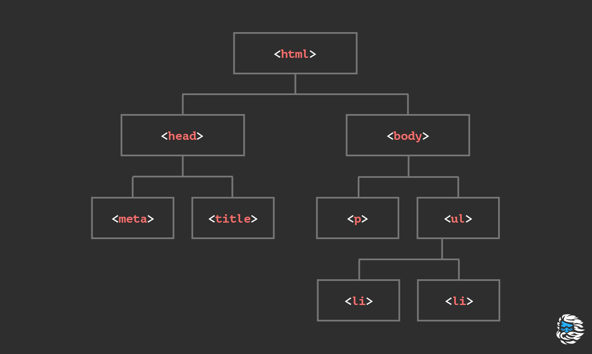

# Лекция 7. DOM: как JavaScript управляет страницей


## Цели лекции

После этой лекции вы сможете:

- объяснить, что такое DOM;
- правильно подключить JavaScript к HTML;
- найти один или несколько элементов;
- безопасно изменить текст элемента;
- работать с атрибутами, `dataset` и CSS-классами;
- создавать, вставлять, удалять и заменять DOM-элементы;
- создавать карточку интерфейса из объекта;
- отрисовывать массив объектов;
- показывать пустое состояние;
- выполнять повторный рендер без дублирования;
- объяснить риски использования `innerHTML`.

До этой лекции наш код в основном работал с данными:

```text
данные -> обработка -> console.log
```

Теперь мы добавляем интерфейс:

```text
данные -> обработка -	 -> страница
```

Главная мысль лекции:

> DOM является отображением данных. Когда данные изменяются, интерфейс нужно обновить предсказуемым способом.

## Что такое DOM



DOM расшифровывается как Document Object Model. Браузер читает HTML и создает из него дерево объектов в памяти.

Исходный HTML:

```html
<body>
  <h1>Course schedule</h1>
  <ul>
    <li>JavaScript</li>
    <li>CSS</li>
  </ul>
</body>
```

Упрощенное DOM-дерево:

```text
Document
└── body
    ├── h1
    └── ul
        ├── li
        └── li
```

HTML-файл и DOM связаны, но это не одно и то же:

- HTML является исходной разметкой;
- DOM является живой структурой в памяти браузера;
- JavaScript изменяет DOM;
- пользователь сразу видит изменения.

### Основные типы узлов

Для начала достаточно знать три типа:

- `Document` - весь документ;
- `Element` - HTML-элемент, например `<h1>` или `<li>`;
- `Text` - текст внутри элемента.

Главный вход в DOM - глобальный объект `document`:

```javascript
console.log(document);
console.log(document.body);
console.log(document.body.children);
```

## Когда выполняется JavaScript

Браузер читает HTML сверху вниз. Если JavaScript запустится раньше, чем нужный элемент будет создан, поиск вернет `null`.

Проблемный вариант:

```html
<head>
  <script src="./index.js"></script>
</head>

<body>
  <h1 id="title">Course schedule</h1>
</body>
```

В момент выполнения скрипта `<h1>` еще может отсутствовать в DOM.

### Подключение в конце `body`

```html
<body>
  <h1 id="title">Course schedule</h1>

  <script src="./index.js"></script>
</body>
```

### Подключение через `defer`

```html
<head>
  <script src="./index.js" defer></script>
</head>
```

`defer` позволяет загружать скрипт параллельно с HTML, но выполнить его после разбора документа.

В этой лекции будем использовать `defer`.

## Поиск элементов


Чтобы изменить элемент, сначала нужно получить ссылку на него.

Основные методы:

```javascript
document.querySelector(selector);
document.querySelectorAll(selector);
document.getElementById(id);
```

### `querySelector`

`querySelector` принимает CSS-селектор и возвращает первый подходящий элемент или `null`:

```html
<h1 id="title">Course schedule</h1>
<p class="description">Upcoming events</p>
```

```javascript
const title = document.querySelector("#title");
const description = document.querySelector(".description");
const firstParagraph = document.querySelector("p");
```

Можно использовать знакомые CSS-селекторы:

```javascript
document.querySelector("header h1");
document.querySelector("[data-event-id]");
document.querySelector(".card.is-active");
```

### `querySelectorAll`

`querySelectorAll` возвращает статический `NodeList` со всеми найденными элементами:

```html
<li class="topic">JavaScript</li>
<li class="topic">CSS</li>
<li class="topic">HTML</li>
```

```javascript
const topics = document.querySelectorAll(".topic");

console.log(topics.length); // 3

topics.forEach((topic) => {
  console.log(topic.textContent);
});
```

Если ничего не найдено, результатом будет пустой `NodeList`:

```javascript
const missingItems = document.querySelectorAll(".missing");

console.log(missingItems.length); // 0
```

`NodeList` похож на массив, но не является полноценным массивом. Если нужны методы массивов, можно создать массив:

```javascript
const topicsArray = [...topics];
```

### `getElementById`

`getElementById` ищет элемент по уникальному `id`:

```javascript
const title = document.getElementById("title");
```

Он возвращает элемент или `null`.

### Старые методы поиска

В существующем коде можно встретить:

```javascript
document.getElementsByClassName("card");
document.getElementsByTagName("li");
```

Они возвращают живую `HTMLCollection`, которая автоматически обновляется при изменении DOM. Эти методы продолжают работать, но в новом коде обычно удобнее использовать `querySelector` и `querySelectorAll`.

## Проверка результата поиска

Если обязательный элемент не найден, дальнейший код не сможет работать:

```javascript
const container = document.querySelector("#event-list");

if (!container) {
  throw new Error("Container #event-list not found");
}
```

Для необязательного элемента подойдет обычная проверка:

```javascript
const banner = document.querySelector(".banner");

if (banner) {
  banner.textContent = "Welcome";
}
```

Частая ошибка:

```javascript
const title = document.querySelector(".main-title");

title.textContent = "Hello";
```

Если селектор неверный, `title` равен `null` и появится `TypeError`.

## Навигация относительно элемента

Иногда нужный элемент удобно получить относительно уже найденного:

```html
<section class="schedule">
  <h2>Today</h2>
  <div class="event-list"></div>
</section>
```

```javascript
const schedule = document.querySelector(".schedule");

console.log(schedule.parentElement);
console.log(schedule.children);
console.log(schedule.firstElementChild);
console.log(schedule.lastElementChild);
console.log(schedule.nextElementSibling);
console.log(schedule.previousElementSibling);
```

В большинстве задач достаточно селекторов и работы внутри известного контейнера.

## Изменение текста

У DOM-элемента есть несколько похожих свойств для работы с содержимым. Они решают разные задачи, поэтому важно не выбирать их случайно.

### `textContent`

`textContent` читает или записывает текст элемента и всех его дочерних узлов. HTML-разметка при записи не интерпретируется.

```javascript
const title = document.querySelector("#title");

title.textContent = "Frontend events";
```

HTML-символы при этом отображаются как текст:

```javascript
title.textContent = "<span>Frontend events</span>";
```

Пользователь увидит строку `<span>Frontend events</span>`, а новый элемент создан не будет.

При записи `textContent` старые дочерние элементы удаляются и заменяются одним текстовым узлом:

```html
<h1 id="title">
  Frontend
  <span>events</span>
</h1>
```

```javascript
title.textContent = "New title";
```

После выполнения внутри `h1` останется только текст `New title`.

Используйте `textContent`, когда нужно:

- вывести имя, комментарий или сообщение пользователя;
- показать данные из API;
- изменить подпись, заголовок, цену или статус;
- прочитать весь текст элемента независимо от CSS;
- записать строку, которая не должна превращаться в HTML.

Для обычной работы с текстом это основной и наиболее безопасный способ.

### `innerText`

`innerText` возвращает текст примерно так, как его видит пользователь. Он учитывает CSS, скрытые элементы и визуальные переносы строк.

```html
<div id="info">
  Visible text
  <span hidden>Hidden text</span>
</div>
```

```javascript
const info = document.querySelector("#info");

console.log(info.textContent);
// содержит Visible text и Hidden text

console.log(info.innerText);
// содержит только видимый текст
```

Чтение `innerText` может потребовать от браузера вычислить расположение и стили элементов. Поэтому не стоит использовать его без необходимости в больших циклах.

Используйте `innerText`, когда действительно нужен текст в том виде, в котором он визуально отображается на странице. Например, для копирования видимой части интерфейса.

Для обычной записи текста предпочитайте `textContent`.

### `innerHTML`

`innerHTML` читает или заменяет HTML-разметку внутри элемента:

```javascript
const container = document.querySelector("#content");

container.innerHTML = `
  <section class="welcome">
    <h2>Welcome</h2>
    <p>Choose an event</p>
  </section>
`;
```

Браузер разбирает строку и создает настоящие DOM-элементы.

При присваивании нового `innerHTML` старые дочерние узлы удаляются. Ссылки на них могут остаться в JavaScript, но они больше не являются частью страницы. Обработчики событий, установленные непосредственно на удаленные элементы, также перестанут работать в интерфейсе.

Используйте `innerHTML`, когда:

- разметка полностью контролируется разработчиком;
- нужно быстро вставить небольшой статический HTML-шаблон;
- внутри строки нет пользовательских или других неизвестных данных;
- пересоздание содержимого контейнера является ожидаемым поведением.

Не используйте `innerHTML`, если в строку подставляются данные формы, URL, `localStorage` или внешнего API без надежной очистки.

| Свойство | Что возвращает или записывает                           | Когда использовать                                                             |
| ---------------- | --------------------------------------------------------------------------------- | ----------------------------------------------------------------------------------------------- |
| `textContent`  | текст всех дочерних узлов, HTML не выполняется | основной способ для текста, данных пользователя и API |
| `innerText`    | визуально отображаемый текст с учетом CSS        | когда нужен именно видимый текст                                    |
| `innerHTML`    | HTML-разметку внутри элемента                               | только для доверенной и контролируемой разметки       |

### Как выбрать способ

Задайте себе два вопроса:

1. Мне нужен текст или HTML-разметка?
2. Полностью ли я контролирую значение?

```text
Нужен обычный текст                         -> textContent
Нужен текст, который сейчас видит пользователь -> innerText
Нужна доверенная HTML-разметка              -> innerHTML
Есть неизвестные данные                     -> textContent или createElement
```

## `innerHTML` и безопасность

`innerHTML` интерпретирует строку как HTML. Если часть строки контролирует другой человек, он может попытаться добавить вредоносную разметку или JavaScript.

Такая уязвимость называется XSS, или Cross-Site Scripting. При XSS чужой код выполняется на странице от имени вашего сайта.

Вредоносный код потенциально может:

- прочитать информацию из DOM;
- получить доступ к данным, доступным JavaScript;
- отправить запрос от имени пользователя;
- изменить содержимое страницы;
- показать поддельную форму входа;
- передать доступные данные на внешний сервер.

`alert()` в учебных примерах только демонстрирует факт выполнения кода. Реальная атака обычно не показывает уведомление.

### Откуда могут прийти опасные данные

Недоверенными нужно считать данные из:

- полей формы;
- параметров URL;
- комментариев и сообщений;
- `localStorage`;
- внешнего API;
- базы данных, если раньше туда мог записать данные пользователь.

Даже ответ API нельзя автоматически считать безопасной HTML-разметкой.

### Пример уязвимости

```javascript
const container = document.querySelector("#content");
const comment = '';

container.innerHTML = comment;
```

Браузер создаст элемент `img`. Загрузка неправильного адреса завершится ошибкой, после чего выполнится код из `onerror`.

### Безопасный вывод через `textContent`

```javascript
container.textContent = comment;
```

Строка будет показана пользователю как текст. Элемент `img` не создастся, а обработчик `onerror` не выполнится.

### Безопасное создание сложного интерфейса

Если нужно создать структуру из неизвестных данных, используйте DOM-методы:

```javascript
const card = document.createElement("article");
const title = document.createElement("h2");
const description = document.createElement("p");

title.textContent = event.title;
description.textContent = event.description;

card.append(title, description);
container.replaceChildren(card);
```

Разметка создается разработчиком, а неизвестные значения записываются только как текст.

### Другие опасные точки вставки

Риск относится не только к `innerHTML`. Осторожность нужна и с:

- `outerHTML`;
- `insertAdjacentHTML()`;
- `document.write()`;
- созданием строковых обработчиков вроде `onclick="..."`;
- динамическими значениями `href` и `src`.

Например, `textContent` не защищает адрес ссылки, если опасная строка записывается в `href`. URL тоже нужно отдельно проверять.

### Если пользователь должен вводить форматированный HTML

Иногда приложение действительно должно поддерживать пользовательское форматирование. В таком случае простого `textContent` недостаточно, потому что он покажет теги как текст.

Для такой задачи применяют проверенную библиотеку очистки HTML с разрешенным списком тегов и атрибутов. Самодельная функция из нескольких `replace()` или `replaceAll()` не является полной защитой.

Правило курса:

> Неизвестные данные вставляем через `textContent`. `innerHTML` используем только для контролируемой разработчиком разметки.

## Атрибуты

HTML-элементы содержат атрибуты:

```html

```

Основные методы:

```javascript
const image = document.querySelector("img");

console.log(image.getAttribute("src"));
console.log(image.hasAttribute("alt"));

image.setAttribute("alt", "JavaScript speaker");
image.removeAttribute("title");
```

Многие стандартные атрибуты доступны как свойства:

```javascript
image.alt = "JavaScript speaker";
image.src = "./images/speaker.jpg";
```

## Пользовательские `data-*` атрибуты

`data-*` позволяют связать DOM-элемент с идентификатором или другим простым значением:

```html
<article class="event-card" data-event-id="15" data-room="A1"></article>
```

Доступ через `dataset`:

```javascript
const card = document.querySelector(".event-card");

console.log(card.dataset.eventId); // "15"
console.log(card.dataset.room); // "A1"
```

Запись:

```javascript
card.dataset.eventId = "20";
card.dataset.status = "active";
```

Значения в `dataset` являются строками:

```javascript
const eventId = Number(card.dataset.eventId);
```

В лекции 8 `dataset` будет использоваться для определения действия и выбранного элемента.

## Классы и стили

### `classList`

```javascript
const card = document.querySelector(".event-card");

card.classList.add("event-card--online");
card.classList.remove("event-card--hidden");
card.classList.toggle("event-card--featured");

console.log(card.classList.contains("event-card--online"));
```

Второй аргумент `toggle` позволяет явно управлять состоянием:

```javascript
card.classList.toggle("event-card--online", event.isOnline);
```

Если `event.isOnline` равен `true`, класс будет добавлен. Если `false`, класс будет удален.

### Прямые стили

```javascript
const progress = document.querySelector(".progress__value");

progress.style.width = "75%";
```

Прямые стили полезны для действительно динамического значения. Обычное оформление лучше хранить в CSS и переключать классами.

```javascript
card.classList.add("event-card--featured");
```

## Создание элементов

`document.createElement()` создает новый элемент в памяти:

```javascript
const message = document.createElement("p");

message.textContent = "Schedule loaded";
message.classList.add("message", "message--success");
message.dataset.status = "success";
```

Пока элемент не вставлен в DOM, пользователь его не видит.

### Вставка

```javascript
const container = document.querySelector("#messages");

container.append(message);
```

Основные методы вставки:

```javascript
container.append(element); // в конец
container.prepend(element); // в начало
existing.before(element); // перед существующим элементом
existing.after(element); // после существующего элемента
```

Один DOM-элемент не может одновременно находиться в двух местах. Повторная вставка перемещает его:

```javascript
const paragraph = document.createElement("p");
paragraph.textContent = "Move me";

firstContainer.append(paragraph);
secondContainer.append(paragraph);
```

После выполнения элемент будет только внутри `secondContainer`.

## Удаление и замена

### `remove`

```javascript
const banner = document.querySelector(".banner");

banner.remove();
```

Переменная продолжает хранить элемент. Его можно изменить и вставить снова:

```javascript
banner.textContent = "Updated banner";
container.append(banner);
```

### `replaceWith`

```javascript
const status = document.querySelector("#status");
const done = document.createElement("p");

done.id = "status";
done.textContent = "Done";
done.classList.add("status--success");

status.replaceWith(done);
```

## Функция создания одного элемента

Когда интерфейс создается из данных, удобно разделять создание одного элемента и рендер всего списка.

Данные:

```javascript
const event = {
  id: 1,
  title: "JavaScript Basics",
  speaker: "Anna",
  room: "A1",
  time: "10:00",
  isOnline: false,
};
```

Функция создания карточки:

```javascript
function createEventCard(event) {
  const card = document.createElement("article");
  card.classList.add("event-card");
  card.classList.toggle("event-card--online", event.isOnline);
  card.dataset.eventId = String(event.id);

  const title = document.createElement("h2");
  title.classList.add("event-card__title");
  title.textContent = event.title;

  const speaker = document.createElement("p");
  speaker.textContent = `Speaker: ${event.speaker}`;

  const time = document.createElement("time");
  time.textContent = event.time;

  const room = document.createElement("p");
  room.textContent = event.isOnline ? "Online" : `Room: ${event.room}`;

  card.append(title, speaker, time, room);

  return card;
}
```

Паттерн:

```text
создать -> настроить -> собрать -> вернуть
```

Функция `createEventCard`:

- получает данные;
- создает один DOM-элемент;
- безопасно записывает текст;
- не ищет контейнер;
- не вставляет карточку на страницу;
- возвращает готовый элемент.

Такую функцию проще тестировать, читать и использовать повторно.

## Рендер массива объектов

Данные:

```javascript
const events = [
  {
    id: 1,
    title: "JavaScript Basics",
    speaker: "Anna",
    room: "A1",
    time: "10:00",
    isOnline: false,
  },
  {
    id: 2,
    title: "Modern CSS",
    speaker: "Petr",
    room: "Online",
    time: "12:00",
    isOnline: true,
  },
];
```

### `DocumentFragment`

`DocumentFragment` является временным контейнером в памяти. В него можно собрать элементы, а затем вставить их одной операцией:

```javascript
const fragment = document.createDocumentFragment();

fragment.append(createEventCard(events[0]));
fragment.append(createEventCard(events[1]));
```

### Функция рендера

```javascript
function renderEvents(events, container) {
  if (events.length === 0) {
    const empty = document.createElement("p");
    empty.classList.add("empty-state");
    empty.textContent = "Events not found";

    container.replaceChildren(empty);
    return;
  }

  const fragment = document.createDocumentFragment();

  events.forEach((event) => {
    fragment.append(createEventCard(event));
  });

  container.replaceChildren(fragment);
}
```

`replaceChildren()` удаляет старое содержимое и вставляет новые узлы. Поэтому повторный рендер не создает дубли:

```javascript
const eventList = document.querySelector("#event-list");

if (!eventList) {
  throw new Error("Container #event-list not found");
}

renderEvents(events, eventList);
renderEvents(events, eventList);
```

После второго вызова карточек останется столько же, сколько элементов в массиве.

### Отдельное пустое состояние

Пустое состояние тоже можно создавать функцией:

```javascript
function createEmptyState(message) {
  const empty = document.createElement("p");
  empty.classList.add("empty-state");
  empty.textContent = message;

  return empty;
}
```

```javascript
function renderEvents(events, container) {
  if (events.length === 0) {
    container.replaceChildren(createEmptyState("Events not found"));
    return;
  }

  const fragment = document.createDocumentFragment();

  events.forEach((event) => {
    fragment.append(createEventCard(event));
  });

  container.replaceChildren(fragment);
}
```

## Рендер через `innerHTML`

Для полностью контролируемых данных иногда используют HTML-строку:

```javascript
function renderStaticTopics(topics, container) {
  const html = topics
    .map((topic) => `<li class="topic">${topic}</li>`)
    .join("");

  container.innerHTML = html;
}
```

Но если `topic` пришел от пользователя или неизвестного API, такая вставка небезопасна.

Сравнение подходов:

| `createElement`                                                             | `innerHTML`                                                                      |
| ----------------------------------------------------------------------------- | ---------------------------------------------------------------------------------- |
| безопасно записывает текст через `textContent` | интерпретирует строку как HTML                              |
| возвращает реальные DOM-узлы                            | пересоздает содержимое контейнера                   |
| удобно настраивать свойства и классы          | удобно для короткой контролируемой разметки |
| основной способ этой лекции                           | дополнительный способ                                          |

Не используйте `innerHTML +=` внутри цикла:

```javascript
events.forEach((event) => {
  container.innerHTML += `<article>${event.title}</article>`;
});
```

На каждой итерации браузер читает текущее содержимое, добавляет строку и создает дочерние элементы заново.

## Доступность динамического интерфейса

JavaScript не отменяет правила семантического HTML:

- карточку можно создавать через `article`;
- для действия используйте `button`, а не `div`;
- изображению нужен понятный `alt`;
- сохраняйте логическую последовательность заголовков;
- не обозначайте состояние только цветом;
- текст ошибки должен объяснять проблему;
- скрытый контент не должен случайно оставаться доступным для клавиатуры.

Плохо:

```javascript
const action = document.createElement("div");
action.textContent = "Open details";
```

Лучше:

```javascript
const action = document.createElement("button");
action.type = "button";
action.textContent = "Open details";
```

Событие клика будет добавлено в следующей лекции.

## Частые ошибки

### Неправильный селектор

```javascript
const title = document.querySelector(".title");

title.textContent = "Hello";
```

Если в HTML используется `id="title"`, результат равен `null`.

### Коллекция вместо элемента

```javascript
const items = document.querySelectorAll(".item");

items.textContent = "Updated";
```

Нужно перебрать коллекцию:

```javascript
items.forEach((item) => {
  item.textContent = "Updated";
});
```

### Карточки дублируются

Если при повторном рендере использовать только `append`, старые элементы останутся. Используйте `replaceChildren` или очищайте контейнер перед вставкой.

### Неизвестные данные вставляются через `innerHTML`

```javascript
container.innerHTML = userComment;
```

Для текста используйте:

```javascript
container.textContent = userComment;
```

### Один элемент вставляется в два места

Вторая вставка перемещает существующий узел. Для каждой карточки вызывайте `createElement` или функцию `create...()` заново.

### Функция создания сама вставляет элемент

Если `createEventCard()` одновременно создает карточку, ищет контейнер и вставляет карточку, ее сложнее использовать повторно. Разделяйте создание и рендер.

### Данные изменяются во время рендера

Функция рендера должна отображать данные, а не неожиданно менять исходный массив или объекты.

## Заключение

Главные выводы:

1. DOM является деревом объектов, созданным браузером из HTML.
2. Скрипт должен выполняться после разбора нужной разметки.
3. `querySelector` возвращает элемент или `null`.
4. `querySelectorAll` возвращает коллекцию.
5. Неизвестный текст безопаснее вставлять через `textContent`.
6. `dataset` связывает элемент с идентификатором или простым значением.
7. Состояние оформления лучше переключать классами.
8. Функция `create...()` создает и возвращает один узел.
9. Функция `render...()` отображает массив и обрабатывает пустое состояние.
10. `replaceChildren()` делает повторный рендер предсказуемым.

### Чек-лист

- могу найти один и несколько элементов;
- проверяю обязательные элементы после поиска;
- умею менять текст, атрибуты и классы;
- понимаю разницу между `textContent` и `innerHTML`;
- умею создать элемент и вставить его в DOM;
- умею создать карточку из объекта;
- умею отрисовать массив объектов;
- показываю пустое состояние;
- повторный рендер не создает дубли;
- неизвестные данные не вставляются через `innerHTML`.

## Практика

### Часть 1. Базовые задачи

1. Найдите заголовок `#page-title`, измените его текст и добавьте класс `page-title--ready`.
2. Найдите все элементы `.topic`, выведите их количество и добавьте каждому класс `topic--visible`.
3. Создайте элемент `p` с текстом `Catalog loaded`, классом `message` и `data-status="success"`. Вставьте его в `#messages`.
4. Создайте кнопку через `createElement`. Задайте `type="button"`, текст и два CSS-класса. Обработчик события пока не добавляйте.
5. Создайте уведомление, вставьте его на страницу, удалите через `remove`, измените текст и вставьте повторно.
6. Найдите элемент с `data-product-id`, получите идентификатор через `dataset` и преобразуйте его в число.
7. Создайте функцию `createEmptyState(message)`, возвращающую DOM-элемент с безопасно записанным текстом.
8. Покажите на странице строку `<strong>User text</strong>` так, чтобы браузер не создавал тег `strong`.

### Часть 2. Каталог товаров

В этом задании нужно применить весь паттерн рендера:

```text
массив товаров
  -> createProductCard(product)
  -> DocumentFragment
  -> renderProducts(products, container)
```

HTML:

```html
<header>
  <h1 id="page-title">Product catalog</h1>
  <div id="products-summary"></div>
</header>

<main>
  <section>
    <h2>Products</h2>
    <div id="product-list"></div>
  </section>
</main>
```

Данные:

```javascript
const products = [
  {
    id: 1,
    title: "Mechanical Keyboard",
    price: 89,
    category: "accessories",
    image: "./images/keyboard.webp",
    inStock: true,
    isFeatured: true,
  },
  {
    id: 2,
    title: "Wireless Mouse",
    price: 45,
    category: "accessories",
    image: "./images/mouse.webp",
    inStock: true,
    isFeatured: false,
  },
  {
    id: 3,
    title: "4K Monitor",
    price: 420,
    category: "displays",
    image: "./images/monitor.webp",
    inStock: false,
    isFeatured: true,
  },
];
```

Реализуйте:

```javascript
createProductCard(product)
createEmptyState(message)
renderProducts(products, container)
renderProductsSummary(products, container)
```

Требования к карточке:

- корневой элемент `article`;
- класс `product-card`;
- `data-product-id`;
- изображение с корректным `alt`;
- заголовок;
- цена с валютой;
- категория;
- текст `In stock` или `Out of stock`;
- класс `product-card--out-of-stock`, если товара нет;
- бейдж `Featured`, если товар отмечен как рекомендуемый;
- кнопка `Open details` без обработчика события.

Пример построения отдельного изображения:

```javascript
function createProductImage(product) {
  const image = document.createElement("img");

  image.classList.add("product-card__image");
  image.src = product.image;
  image.alt = product.title;

  return image;
}
```

Внутри `createProductCard` вызовите `createProductImage` и соберите остальные элементы карточки.

Сводка каталога показывает:

- общее количество товаров;
- количество товаров в наличии;
- количество рекомендуемых товаров;
- минимальную и максимальную цену;
- понятный текст для пустого массива.

Проверьте рендер:

1. полного массива;
2. только товаров в наличии;
3. только рекомендуемых товаров;
4. товаров дешевле `100`;
5. пустого массива;
6. полного массива после пустого результата.

При каждом вызове контейнер должен содержать только актуальные карточки.

### Часть 3. Карточки пользователей

Это самостоятельное задание на перенос того же паттерна в другую предметную область.

HTML:

```html
<section class="users">
  <div class="users__header">
    <h2>Team members</h2>
    <div id="users-summary"></div>
  </div>

  <div id="user-list"></div>
</section>
```

Данные:

```javascript
const users = [
  {
    id: 1,
    name: "Anna Novak",
    role: "Frontend Developer",
    email: "anna@example.com",
    city: "Prague",
    avatar: "./images/anna.webp",
    isActive: true,
  },
  {
    id: 2,
    name: "Petr Svoboda",
    role: "Designer",
    email: "petr@example.com",
    city: "Brno",
    avatar: "./images/petr.webp",
    isActive: false,
  },
  {
    id: 3,
    name: "<b>Maria</b>",
    role: "Project Manager",
    email: "maria@example.com",
    city: "Prague",
    avatar: "./images/maria.webp",
    isActive: true,
  },
];
```

Имя третьего пользователя специально содержит HTML-теги. На странице они должны отображаться как текст, а не как разметка.

Реализуйте:

```javascript
createUserCard(user)
renderUsers(users, container)
renderUsersSummary(users, container)
```

Требования к карточке:

- корневой элемент `article`;
- класс `user-card`;
- `data-user-id`;
- аватар с `alt`;
- имя через `textContent`;
- роль;
- email;
- город;
- текстовый статус `Active` или `Inactive`;
- класс `user-card--inactive` для неактивного пользователя;
- кнопка `View profile` без обработчика события.

Сводка пользователей показывает:

- общее количество;
- количество активных;
- количество неактивных;
- количество пользователей из Праги.

Проверьте рендер:

1. всех пользователей;
2. только активных;
3. только пользователей из Праги;
4. пустого массива;
5. всех пользователей после пустого результата.

Сравните реализации товаров и пользователей:

- какие действия совпадают;
- какие свойства отличаются;
- почему обе функции рендера имеют похожую структуру;
- почему функции создания карточек должны оставаться отдельными.

### Часть 4. Debugging

Сначала предскажите результат, затем исправьте код.

#### Ошибка 1. Неправильный селектор

```javascript
const title = document.querySelector(".page-title");
title.textContent = "Updated";
```

В HTML элемент имеет `id="page-title"`.

#### Ошибка 2. Коллекция

```javascript
const cards = document.querySelectorAll(".card");
cards.classList.add("card--ready");
```

#### Ошибка 3. Дублирование

```javascript
function renderItems(items, container) {
  items.forEach((item) => {
    const element = document.createElement("p");
    element.textContent = item;
    container.append(element);
  });
}

renderItems(["A", "B"], container);
renderItems(["A", "B"], container);
```

#### Ошибка 4. Небезопасная вставка

```javascript
const userText = '';
container.innerHTML = userText;
```

#### Ошибка 5. Перемещение одного узла

```javascript
const card = document.createElement("article");

firstContainer.append(card);
secondContainer.append(card);
```

## Домашняя работа

> Общие условия:
>
> - Подключите JavaScript через `defer`.
> - Используйте `const` для ссылок на DOM-элементы.
> - Проверяйте обязательные контейнеры.
> - Не вставляйте неизвестные данные через `innerHTML`.
> - Не добавляйте обработчики событий. Они будут в следующей лекции.

Используйте эти данные в заданиях:

```javascript
const navigationItems = [
  { label: "Home", href: "./index.html", isCurrent: false },
  { label: "Courses", href: "./courses.html", isCurrent: true },
  { label: "Teachers", href: "./teachers.html", isCurrent: false },
  { label: "Contacts", href: "./contacts.html", isCurrent: false },
];

const students = [
  { id: 1, name: "Anna", score: 82, isActive: true },
  { id: 2, name: "Max", score: 48, isActive: false },
  { id: 3, name: "Sofia", score: 67, isActive: true },
  { id: 4, name: "Leo", score: 91, isActive: true },
];
```

1. Подготовьте начальную HTML-разметку:

   ```html
   <div id="app">
     <h1 id="main-title">Loading...</h1>
     <p class="description">Please wait</p>
     <section id="summary"></section>
     <section id="students-list"></section>
   </div>
   ```
   Найдите заголовок и описание, проверьте их наличие, измените текст через `textContent` и добавьте классы `page-title` и `description--ready`.

   Ожидаемый текст заголовка: `Course results`.
2. Создайте в HTML список изученных технологий:

   ```html
   <ul id="technologies">
     <li class="technology">HTML</li>
     <li class="technology">CSS</li>
     <li class="technology">JavaScript</li>
     <li class="technology">Vite</li>
   </ul>
   ```
   Получите все элементы `.technology` через `querySelectorAll`, добавьте каждому класс `technology--visible` и создайте массив их текстов.

   Ожидаемый массив: `["HTML", "CSS", "JavaScript", "Vite"]`.
3. Добавьте в HTML информационный блок:

   ```html
   <article id="course-info" data-course-id="7" data-level="basic">
     
   </article>
   ```
   Через JavaScript:

   - получите `courseId` через `dataset` и преобразуйте его в число;
   - измените `data-level` на `intermediate`;
   - добавьте `data-status="active"`;
   - замените `src` изображения;
   - задайте `alt="Students learning JavaScript"`;
   - добавьте и затем удалите атрибут `title`.
4. Напишите функцию `createMessage(text, type)`.

   Примеры вызова:

   ```javascript
   createMessage("Data loaded", "success");
   createMessage("Students not found", "warning");
   ```
   Функция возвращает элемент `p` с классами `message` и `message--${type}`, атрибутом `data-type` и безопасно записанным текстом.

   Первый вызов должен создать:

   ```html
   <p class="message message--success" data-type="success">Data loaded</p>
   ```
5. Напишите функцию `createNavigation(items)`, которая создает и возвращает такую структуру:

   ```html
   <nav aria-label="Main navigation">
     <ul class="navigation__list">
       <li><a class="navigation__link" href="./index.html">Home</a></li>
       <!-- остальные ссылки создаются из navigationItems -->
     </ul>
   </nav>
   ```
   Текущая ссылка должна дополнительно получить класс `navigation__link--current` и атрибут `aria-current="page"`. Все элементы создавайте через `createElement`, текст записывайте через `textContent`.
6. Напишите функцию `createPageHeader(siteName, items)`.

   Пример вызова:

   ```javascript
   const header = createPageHeader("Frontend School", navigationItems);
   document.body.prepend(header);
   ```
   Ожидаемая структура:

   ```html
   <header class="page-header">
     <a class="page-header__logo" href="./index.html">Frontend School</a>
     <!-- результат createNavigation(items) -->
   </header>
   ```
   Используйте внутри уже готовую функцию `createNavigation`. Функция должна только создать и вернуть шапку, но не вставлять ее на страницу.
7. Напишите функцию `createStudentCard(student)`.

   Для объекта:

   ```javascript
   { id: 1, name: "Anna", score: 82, isActive: true }
   ```
   функция должна вернуть приблизительно такую структуру:

   ```html
   <article class="student-card student-card--passed" data-student-id="1">
     <h2 class="student-card__name">Anna</h2>
     <p class="student-card__score">Score: 82</p>
     <p class="student-card__status">Active</p>
   </article>
   ```
   Если балл меньше `60`, класс `student-card--passed` не добавляется. Для неактивного студента покажите текст `Inactive`.
8. Напишите функции `createEmptyState(message)` и `renderStudents(items, container)`.

   `renderStudents` должна:

   - создавать карточки через `createStudentCard`;
   - собирать их в `DocumentFragment`;
   - заменять содержимое контейнера через `replaceChildren`;
   - показывать `createEmptyState("Students not found")`, если массив пустой.

   Проверьте последовательность:

   ```javascript
   renderStudents(students, studentsContainer);
   renderStudents(students.filter((student) => student.score >= 60), studentsContainer);
   renderStudents([], studentsContainer);
   renderStudents(students, studentsContainer);
   ```
   После каждого вызова старые карточки не должны оставаться в контейнере.
9. Напишите функцию `renderStudentsSummary(items, container)`.

   Для массива `students` она должна показать:

   - `Total: 4`;
   - `Passed: 3`;
   - `Active: 3`;
   - `Average score: 72`.

   Можно округлить средний балл через `Math.round`. Для пустого массива покажите сообщение `No data for summary`.
10. Соберите итоговую страницу `Course results` из выполненных задач.

    На странице должны быть:

    - шапка с логотипом и навигацией;
    - заголовок и описание курса;
    - сводка результатов;
    - карточки студентов;
    - информационный блок с изображением;
    - сообщение для пустого массива.

    Вызовите функции в таком порядке:

    ```javascript
    const header = createPageHeader("Frontend School", navigationItems);
    document.body.prepend(header);

    renderStudentsSummary(students, summaryContainer);
    renderStudents(students, studentsContainer);
    ```
    В конце JavaScript-файла напишите комментарий:

    - где использован `textContent`;
    - где использован `dataset`;
    - почему повторный рендер не создает дубли;
    - почему данные из объектов не вставляются через `innerHTML`.
