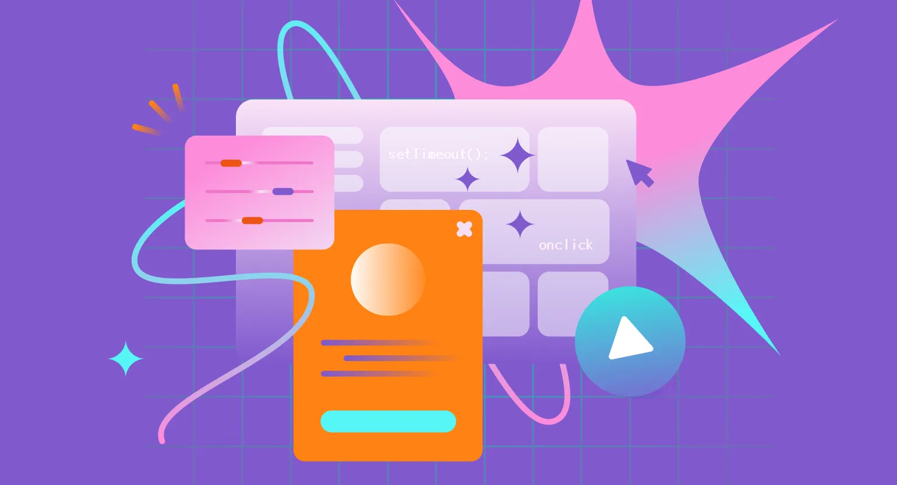
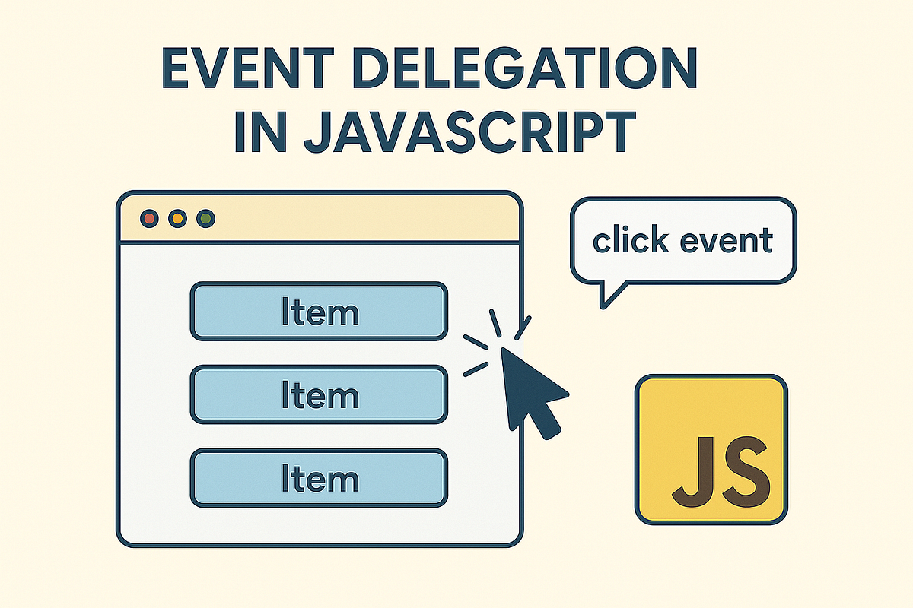
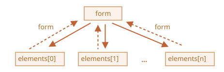

# Лекция 8. События и формы: интерактивные страницы



## Цели лекции

После лекции вы сможете:

- подписываться на события через `addEventListener()`;
- передавать обработчик как функцию;
- получать информацию из объекта `event`;
- различать `event.target` и `event.currentTarget`;
- отменять стандартное поведение браузера через `preventDefault()`;
- использовать всплытие и делегирование событий;
- читать значения полей формы;
- собирать данные через `FormData`;
- выполнять базовую проверку данных;
- показывать пользователю понятные и доступные сообщения об ошибках.

## Зачем нужны события

В прошлой лекции мы научились находить DOM-элементы, изменять их и создавать новые.

Но пока страница выполняла действия только тогда, когда запускался JavaScript. Чтобы интерфейс реагировал на пользователя, нужны события.

Событие может произойти, когда пользователь:

- нажал кнопку;
- ввел текст;
- выбрал значение;
- отправил форму;
- нажал клавишу;
- перевел фокус на другое поле.

Браузер также создает события самостоятельно, например после загрузки страницы или изменения размера окна.

Схема работы:

```text
Событие -> обработчик -> изменение интерфейса
```

Например:

```text
Пользователь нажал Like
-> браузер создал событие click
-> обработчик изменил состояние
-> кнопка показала Liked
```

## Первый обработчик события

Создадим кнопку:

```html
<button id="like-button" type="button">Like</button>
```

Найдем ее и подпишемся на событие `click`:

```javascript
const likeButton = document.querySelector("#like-button");

if (likeButton) {
  likeButton.addEventListener("click", function () {
    likeButton.textContent = "Liked";
  });
}
```

Метод `addEventListener()` получает два основных аргумента:

```javascript
element.addEventListener("eventName", handler);
```

- `eventName` - название события;
- `handler` - функция, которая выполнится после события.

### Передаем функцию, а не вызываем ее

Рассмотрим обработчик:

```javascript
function handleLike() {
  console.log("Liked");
}
```

Правильно:

```javascript
likeButton.addEventListener("click", handleLike);
```

Неправильно:

```javascript
likeButton.addEventListener("click", handleLike());
```

Во втором варианте функция вызывается сразу при выполнении файла. В `addEventListener()` попадет результат ее вызова, а не сама функция.

Мини-правило:

> В `addEventListener()` передаем ссылку на функцию.

### Именованная функция или стрелочная

Для короткой реакции можно использовать стрелочную функцию:

```javascript
likeButton.addEventListener("click", () => {
  console.log("Liked");
});
```

Если логика занимает несколько строк или может понадобиться повторно, удобнее именованная функция:

```javascript
function handleLikeClick() {
  likeButton.classList.toggle("like-button--active");

  const isActive = likeButton.classList.contains("like-button--active");
  likeButton.textContent = isActive ? "Liked" : "Like";
  likeButton.setAttribute("aria-pressed", String(isActive));
}

likeButton.addEventListener("click", handleLikeClick);
```

Атрибут `aria-pressed` сообщает вспомогательным технологиям, включено ли состояние кнопки.

### Как удалить обработчик

Для удаления используется `removeEventListener()`:

```javascript
likeButton.removeEventListener("click", handleLikeClick);
```

Удалить обработчик можно только по той же ссылке на функцию.

Этот код не удалит обработчик:

```javascript
likeButton.addEventListener("click", () => console.log("Click"));
likeButton.removeEventListener("click", () => console.log("Click"));
```

Здесь созданы две разные функции.

В большинстве задач этой лекции удалять обработчики не понадобится. Но важно понимать, почему для этого удобны именованные функции.

## Другие способы назначения обработчика

В HTML можно встретить встроенный обработчик:

```html
<button onclick="alert('Clicked')">Click</button>
```

Также существует DOM-свойство `onclick`:

```javascript
likeButton.onclick = function () {
  console.log("Clicked");
};
```

В курсе используем `addEventListener()`, потому что он:

- не смешивает HTML и JavaScript;
- позволяет назначить несколько обработчиков;
- поддерживает удаление обработчика;
- лучше подходит для развития проекта.

## Основные события

На этом этапе достаточно знать несколько событий.

### События интерфейса

- `click` - пользователь нажал элемент;
- `keydown` - пользователь нажал клавишу;
- `input` - значение поля изменилось;
- `change` - пользователь зафиксировал новое значение;
- `submit` - пользователь отправил форму;
- `focus` - элемент получил фокус;
- `focusout` - фокус ушел с элемента.

### `input` и `change`

`input` срабатывает при каждом изменении значения:

```javascript
const searchInput = document.querySelector("#search");

searchInput.addEventListener("input", function () {
  console.log(searchInput.value);
});
```

Это удобно для живого поиска и счетчика символов.

`change` обычно используют, когда пользователь выбрал и зафиксировал новое значение:

```javascript
const categorySelect = document.querySelector("#category");

categorySelect.addEventListener("change", function () {
  console.log(categorySelect.value);
});
```

Это удобно для `select`, checkbox и переключателей настроек.

## Объект события `event`



Когда происходит событие, браузер вызывает обработчик и передает ему объект `event`.

```javascript
function handleButtonClick(event) {
  console.log(event);
}

likeButton.addEventListener("click", handleButtonClick);
```

Объект содержит информацию о произошедшем событии.

### `event.type`

Свойство `type` содержит название события:

```javascript
function handleButtonClick(event) {
  console.log(event.type);
}

likeButton.addEventListener("click", handleButtonClick);
// После клика: "click"
```

### `event.target`

`event.target` указывает на элемент, на котором событие началось.

```html
<button id="cart-button" type="button">
  <span aria-hidden="true">🛒</span>
  Add to cart
</button>
```

```javascript
const cartButton = document.querySelector("#cart-button");

cartButton.addEventListener("click", function (event) {
  console.log(event.target);
});
```

Если пользователь нажмет значок `span`, значением `target` будет именно `span`.

### `event.currentTarget`

`event.currentTarget` указывает на элемент, которому назначен текущий обработчик.

```javascript
cartButton.addEventListener("click", function (event) {
  console.log(event.target);
  console.log(event.currentTarget);
});
```

Если нажать значок внутри кнопки:

- `target` будет указывать на `span`;
- `currentTarget` будет указывать на `button`.

Мини-правило:

> `target` - где началось событие.
>
> `currentTarget` - где выполняется обработчик.

В обработчике одной кнопки часто удобнее работать с `currentTarget`:

```javascript
cartButton.addEventListener("click", function (event) {
  event.currentTarget.classList.toggle("button--active");
});
```

### `preventDefault()`

У некоторых элементов есть стандартное поведение браузера:

- ссылка открывает адрес из `href`;
- форма отправляет данные;
- кнопка `type="submit"` запускает отправку формы.

Метод `preventDefault()` отменяет это поведение.

```javascript
const form = document.querySelector("#registration-form");

form.addEventListener("submit", function (event) {
  event.preventDefault();
  console.log("The page was not reloaded");
});
```

Не нужно отменять стандартное поведение автоматически для каждого события. Используйте `preventDefault()` только тогда, когда JavaScript действительно берет управление на себя.

## Всплытие событий

Большинство событий сначала возникает на целевом элементе, а затем поднимается по дереву DOM к его родителям.

Наглядную схему и интерактивные примеры всплытия и делегирования можно посмотреть в материале [«Событийная модель» на Доке](https://doka.guide/js/events/). Откройте демонстрации на странице и проследите, в каком порядке срабатывают обработчики вложенных элементов.

Рассмотрим разметку:

```html
<article class="product-card">
  <button type="button">
    <span>Add to cart</span>
  </button>
</article>
```

После клика по `span` событие проходит такой путь:

```text
span -> button -> article -> body -> document
```

Благодаря всплытию родитель может обрабатывать события дочерних элементов.

### `stopPropagation()`

Метод `stopPropagation()` останавливает дальнейшее всплытие:

```javascript
button.addEventListener("click", function (event) {
  event.stopPropagation();
});
```

Используйте его только при реальной необходимости. Необдуманный вызов `stopPropagation()` может сломать делегирование и другие обработчики выше по дереву.

Для большинства задач этой лекции он не нужен.

## Делегирование событий

Делегирование - это прием, при котором один обработчик назначается общему родителю.

Это особенно удобно, когда:

- элементов много;
- карточки создаются из массива;
- список повторно рендерится;
- элементы добавляются после загрузки страницы.

### Проблема отдельных обработчиков

Можно найти все кнопки и назначить обработчик каждой:

```javascript
const buttons = document.querySelectorAll(".product-card__button");

buttons.forEach((button) => {
  button.addEventListener("click", handleProductAction);
});
```

Но после повторного рендера появятся новые кнопки. Старые обработчики не будут автоматически назначены новым элементам.

### Один обработчик на контейнер

Исходная разметка:

```html
<section id="products">
  <article class="product-card" data-product-id="1">
    <h2>Keyboard</h2>
    <button type="button" data-action="favorite">
      <span aria-hidden="true">☆</span>
      Favorite
    </button>
    <button type="button" data-action="cart">
      Add to cart
    </button>
  </article>
</section>
```

Обработчик:

```javascript
const productsContainer = document.querySelector("#products");

function handleProductsClick(event) {
  if (!(event.target instanceof Element)) return;

  const actionButton = event.target.closest("[data-action]");
  if (!actionButton) return;

  const productCard = actionButton.closest("[data-product-id]");
  if (!productCard) return;

  const action = actionButton.dataset.action;
  const productId = Number(productCard.dataset.productId);

  if (action === "favorite") {
    console.log("Favorite:", productId);
  }

  if (action === "cart") {
    console.log("Add to cart:", productId);
  }
}

productsContainer.addEventListener("click", handleProductsClick);
```

Здесь:

- обработчик назначен контейнеру;
- `closest("[data-action]")` находит кнопку, даже если клик был по вложенному `span`;
- `closest("[data-product-id]")` находит карточку;
- `dataset.action` сообщает действие;
- `dataset.productId` сообщает, с каким товаром работать.

### Почему проверяем `event.target`

Тип `EventTarget` шире, чем `Element`. Метод `closest()` принадлежит элементам.

Проверка делает код явным и защищает обращение к `closest()`:

```javascript
function handleClick(event) {
  if (!(event.target instanceof Element)) return;

  // Работа с event.target
}
```

### Состояние отдельно от интерфейса

Не стоит использовать текст кнопки как единственный источник данных.

Лучше хранить выбранные идентификаторы отдельно:

```javascript
let favoriteIds = [];

function toggleFavorite(productId) {
  const isFavorite = favoriteIds.includes(productId);

  if (isFavorite) {
    favoriteIds = favoriteIds.filter((id) => id !== productId);
  } else {
    favoriteIds = [...favoriteIds, productId];
  }
}
```

После изменения данных интерфейс можно обновить отдельно.

## Мини-практика: делегирование

Дана разметка:

```html
<ul id="notifications">
  <li data-notification-id="101">
    Course starts tomorrow
    <button type="button" data-action="remove">Remove</button>
  </li>
  <li data-notification-id="102">
    New homework is available
    <button type="button" data-action="remove">Remove</button>
  </li>
</ul>
```

Назначьте один обработчик на `#notifications`. После клика по кнопке:

1. найдите кнопку через `closest()`;
2. найдите `li` с идентификатором;
3. выведите идентификатор в консоль;
4. удалите найденный `li`.

## Формы



Форма позволяет пользователю передать данные:

- выполнить поиск;
- зарегистрироваться;
- войти в аккаунт;
- оставить комментарий;
- оформить заказ;
- настроить фильтры.

Форма является DOM-элементом, а ее поля доступны из JavaScript.

## Правильная начальная разметка формы

```html
<form id="registration-form">
  <div class="field">
    <label for="user-name">Name</label>
    <input
      id="user-name"
      name="name"
      type="text"
      autocomplete="name"
    >
  </div>

  <div class="field">
    <label for="user-email">Email</label>
    <input
      id="user-email"
      name="email"
      type="email"
      autocomplete="email"
    >
  </div>

  <div class="field">
    <label for="direction">Direction</label>
    <select id="direction" name="direction">
      <option value="">Choose a direction</option>
      <option value="frontend">Frontend</option>
      <option value="backend">Backend</option>
      <option value="design">Design</option>
    </select>
  </div>

  <label>
    <input name="agree" type="checkbox">
    I agree with the rules
  </label>

  <button type="submit">Register</button>
</form>
```

Обратите внимание:

- у каждого поля есть `name`;
- `label` связан с полем;
- кнопка отправки имеет `type="submit"`;
- обычные кнопки внутри формы должны иметь `type="button"`.

Если не указать тип кнопки, внутри формы она по умолчанию может отправить форму.

## Поиск формы и полей

```javascript
const registrationForm = document.querySelector("#registration-form");

if (!registrationForm) {
  throw new Error("Registration form not found");
}
```

Коллекция `form.elements` содержит элементы управления формы.

```javascript
const nameInput = registrationForm.elements.name;
const emailInput = registrationForm.elements.email;
const directionSelect = registrationForm.elements.direction;
const agreeCheckbox = registrationForm.elements.agree;
```

Доступ по `name` удобен, когда структура формы уже известна.

## Чтение разных полей

### Текстовые поля и `textarea`

Используем свойство `value`:

```javascript
const name = registrationForm.elements.name.value.trim();
const email = registrationForm.elements.email.value.trim();
```

Метод `trim()` удаляет пробелы в начале и конце строки.

### `select`

Выбранное значение также доступно через `value`:

```javascript
const direction = registrationForm.elements.direction.value;
```

### Checkbox

Для checkbox важно состояние `checked`:

```javascript
const agree = registrationForm.elements.agree.checked;
```

Результат будет логическим значением `true` или `false`.

### Radio

Дадим radio-кнопкам одинаковое имя:

```html
<label>
  <input type="radio" name="format" value="online">
  Online
</label>

<label>
  <input type="radio" name="format" value="offline">
  Offline
</label>
```

Выбранное значение можно получить через `:checked`:

```javascript
const selectedFormat = registrationForm.querySelector(
  'input[name="format"]:checked'
);

const format = selectedFormat?.value ?? "";
```

## Отправка формы

Событие `submit` происходит, когда пользователь:

- нажимает кнопку `type="submit"`;
- нажимает Enter в подходящем поле;
- запускает отправку другим стандартным способом.

Поэтому отправку нужно обрабатывать на форме, а не только через `click` кнопки.

```javascript
registrationForm.addEventListener("submit", function (event) {
  event.preventDefault();

  const values = {
    name: registrationForm.elements.name.value.trim(),
    email: registrationForm.elements.email.value.trim(),
    direction: registrationForm.elements.direction.value,
    agree: registrationForm.elements.agree.checked,
  };

  console.log(values);
});
```

## `FormData`

`FormData` собирает успешные поля формы по их атрибутам `name`.

```javascript
registrationForm.addEventListener("submit", function (event) {
  event.preventDefault();

  const formData = new FormData(registrationForm);
  const values = Object.fromEntries(formData.entries());

  console.log(values);
});
```

Возможный результат:

```javascript
const values = {
  name: "Anna",
  email: "anna@example.com",
  direction: "frontend",
  agree: "on"
};
```

### Важные особенности `FormData`

- значения обычно представлены строками;
- поле без `name` не попадет в данные;
- неотмеченный checkbox не попадет в данные;
- несколько полей с одним именем требуют `formData.getAll()`;
- файл представлен объектом `File`.

Если важны типы, удобно явно собрать объект:

```javascript
function getRegistrationValues(form) {
  return {
    name: form.elements.name.value.trim(),
    email: form.elements.email.value.trim(),
    direction: form.elements.direction.value,
    agree: form.elements.agree.checked,
  };
}
```

`FormData` удобно использовать для общей отправки, а ручное чтение - для правил и преобразования типов.

## Сброс формы

Метод `reset()` возвращает поля к начальным значениям:

```javascript
registrationForm.reset();
```

Он не удаляет автоматически:

- сообщения об ошибках, созданные через JavaScript;
- классы ошибок;
- пользовательские блоки успеха;
- данные, которые хранятся в массивах или объектах.

Эти состояния нужно очищать отдельно.

## Валидация формы

Валидация - это проверка введенных значений.

Она помогает:

- не отправлять пустые обязательные поля;
- объяснить пользователю ошибку;
- привести данные к ожидаемому формату.

Проверка в браузере улучшает интерфейс, но не заменяет проверку на сервере. Пользователь может изменить клиентский код или отправить запрос другим способом.

### Встроенная валидация HTML

HTML уже предоставляет полезные атрибуты:

```html
<input name="name" type="text" required minlength="2">
<input name="email" type="email" required>
```

Для многих форм этого достаточно.

В учебном примере мы используем `novalidate`, чтобы самостоятельно показать алгоритм проверки и вывода ошибок:

```html
<form id="registration-form" novalidate>
  <!-- fields -->
</form>
```

В реальном проекте не отключайте встроенную проверку без причины.

## Доступный вывод ошибок

Подготовим разметку одного поля:

```html
<div class="field">
  <label for="user-email">Email</label>
  <input
    id="user-email"
    name="email"
    type="email"
    aria-describedby="email-error"
  >
  <small
    id="email-error"
    class="field__error"
    data-error-for="email"
  ></small>
</div>
```

Функция вывода ошибки:

```javascript
function setFieldError(form, fieldName, message) {
  const field = form.elements[fieldName];
  const errorElement = form.querySelector(
    '[data-error-for="' + fieldName + '"]'
  );

  if (errorElement) {
    errorElement.textContent = message;
  }

  if (field instanceof HTMLElement) {
    field.setAttribute("aria-invalid", String(Boolean(message)));
  }
}
```

Текст записывается через `textContent`. Неизвестные данные не вставляются через `innerHTML`.

Функция очистки ошибок:

```javascript
function clearFormErrors(form) {
  const errorElements = form.querySelectorAll("[data-error-for]");

  errorElements.forEach((element) => {
    element.textContent = "";
  });

  const invalidFields = form.querySelectorAll('[aria-invalid="true"]');

  invalidFields.forEach((field) => {
    field.setAttribute("aria-invalid", "false");
  });
}
```

## Функция проверки данных

Функция валидации не должна искать DOM-элементы. Она получает обычный объект и возвращает объект ошибок.

```javascript
function validateRegistration(values) {
  const errors = {};

  if (values.name.length < 2) {
    errors.name = "Enter at least 2 characters";
  }

  if (!values.email) {
    errors.email = "Email is required";
  } else if (!values.email.includes("@")) {
    errors.email = "Enter a valid email";
  }

  if (!values.direction) {
    errors.direction = "Choose a direction";
  }

  if (!values.agree) {
    errors.agree = "You must accept the rules";
  }

  return errors;
}
```

Такую функцию проще читать и проверять отдельно от интерфейса.

## Валидация при отправке

Подготовим общий блок результата:

```html
<p id="form-status" aria-live="polite"></p>
```

Обработчик:

```javascript
const formStatus = document.querySelector("#form-status");

function showErrors(form, errors) {
  for (const [fieldName, message] of Object.entries(errors)) {
    setFieldError(form, fieldName, message);
  }
}

function handleRegistrationSubmit(event) {
  event.preventDefault();

  clearFormErrors(registrationForm);
  formStatus.textContent = "";

  const values = getRegistrationValues(registrationForm);
  const errors = validateRegistration(values);

  if (Object.keys(errors).length > 0) {
    showErrors(registrationForm, errors);
    formStatus.textContent = "Check the form fields";
    return;
  }

  console.log("Valid data:", values);
  formStatus.textContent = "Registration completed";
  registrationForm.reset();
}

registrationForm.addEventListener("submit", handleRegistrationSubmit);
```

Атрибут `aria-live="polite"` помогает сообщить об изменении статуса пользователям вспомогательных технологий.

## Очистка ошибки при вводе

После исправления поля старое сообщение не должно оставаться на экране.

```javascript
registrationForm.addEventListener("input", function (event) {
  if (!(event.target instanceof HTMLInputElement)) return;
  if (!event.target.name) return;

  setFieldError(registrationForm, event.target.name, "");
});
```

Для `select` можно также слушать `change`:

```javascript
registrationForm.addEventListener("change", function (event) {
  if (!(event.target instanceof HTMLSelectElement)) return;
  if (!event.target.name) return;

  setFieldError(registrationForm, event.target.name, "");
});
```

Точечную проверку после потери фокуса можно добавить позже через `focusout`. Для первого решения достаточно:

- полной проверки на `submit`;
- очистки ошибки текущего поля на `input` или `change`.

## Частые ошибки

### Обработчик вызывается сразу

Неправильно:

```javascript
button.addEventListener("click", handleClick());
```

Правильно:

```javascript
button.addEventListener("click", handleClick);
```

### Слушается клик кнопки вместо отправки формы

Неправильно:

```javascript
submitButton.addEventListener("click", handleSubmit);
```

Правильно:

```javascript
form.addEventListener("submit", handleSubmit);
```

`submit` учитывает не только клик, но и отправку с клавиатуры.

### Забыли `preventDefault()`

Если JavaScript полностью обрабатывает учебную форму, без `preventDefault()` страница может перезагрузиться.

### У кнопки внутри формы не указан тип

```html
<button type="button">Show password</button>
<button type="submit">Register</button>
```

Явно указывайте назначение кнопки.

### Используется `event.target` без `closest()`

Пользователь может нажать вложенную иконку или `span`. В делегировании ищите действие через `closest("[data-action]")`.

### Обработчики назначаются карточкам после каждого рендера

При повторном рендере старые элементы удаляются. Делегированный обработчик на постоянном контейнере продолжает работать с новыми карточками.

### Checkbox читается через `value`

`value` checkbox не сообщает, отмечено ли поле. Используйте `checked`.

### Ошибка вставляется через `innerHTML`

Текст ошибки может содержать неизвестные данные. Используйте `textContent`.

### Валидация смешана с DOM

Лучше разделять:

```text
getValues() -> validate(values) -> showErrors(errors)
```

Каждая функция отвечает за одну задачу.

## Заключение

1. Событие сообщает, что произошло в браузере.
2. `addEventListener()` подписывает элемент на событие.
3. В обработчик передается функция, а не результат ее вызова.
4. `event.target` указывает место начала события.
5. `event.currentTarget` указывает элемент с обработчиком.
6. `preventDefault()` отменяет стандартное поведение.
7. Всплытие позволяет родителю получать события дочерних элементов.
8. Делегирование использует один обработчик для группы элементов.
9. Форму нужно обрабатывать через событие `submit`.
10. Текстовые значения читаются через `value`, checkbox - через `checked`.
11. `FormData` собирает поля с атрибутом `name`.
12. Валидацию данных полезно отделять от работы с DOM.
13. Ошибки нужно выводить безопасно и понятно.
14. Клиентская проверка не заменяет серверную.

### Чек-лист

Перед завершением работы проверьте:

- у обычных кнопок есть `type="button"`;
- отправка обрабатывается на форме;
- при необходимости вызван `preventDefault()`;
- в делегировании используется `closest()`;
- идентификатор из `dataset` преобразован в число;
- ошибки выводятся через `textContent`;
- поле с ошибкой получает `aria-invalid`;
- сообщение о результате находится в `aria-live`;
- после успешной отправки форма сбрасывается;
- состояние приложения не хранится только в тексте кнопок.

## Практика

Практика состоит из независимых частей. Не нужно собирать их в один проект.

### Часть 1. Простые события

1. Создайте кнопку `Show message` и абзац. После клика покажите в абзаце текст `Button clicked`.
2. Создайте кнопку темы. После каждого клика:

   - переключайте класс `panel--dark` у блока;
   - меняйте текст `Dark theme` и `Light theme`;
   - обновляйте `aria-pressed`.
3. Создайте счетчик с кнопками `+1` и `-1`. Храните число в переменной и отображайте его после каждого действия.
4. Создайте поле `textarea` с ограничением `maxlength="120"`. На событии `input` показывайте текст:

   ```text
   35 / 120
   ```
5. Создайте `select` с вариантами языка. На `change` выводите выбранное значение.
6. Исправьте ошибку:

   ```javascript
   function handleSave() {
     console.log("Saved");
   }

   saveButton.addEventListener("click", handleSave());
   ```

### Часть 2. Карточки товаров и делегирование

Используйте данные:

```javascript
const products = [
  { id: 1, title: "Keyboard", price: 80, isAvailable: true },
  { id: 2, title: "Mouse", price: 35, isAvailable: true },
  { id: 3, title: "Monitor", price: 240, isAvailable: false },
];
```

Подготовьте контейнеры:

```html
<p>
  Favorites: <span id="favorites-count">0</span>
</p>
<p>
  Cart: <span id="cart-count">0</span>
</p>
<section id="products"></section>
<p id="catalog-status" aria-live="polite"></p>
```

Карточка должна содержать:

```html
<article class="product-card" data-product-id="1">
  <h2>Keyboard</h2>
  <p>Price: 80</p>
  <button type="button" data-action="favorite" aria-pressed="false">
    Favorite
  </button>
  <button type="button" data-action="cart">
    Add to cart
  </button>
</article>
```

Выполните задачи:

1. Создайте `createProductCard(product)` и `renderProducts(products, container)`.
2. Создайте массивы `favoriteIds` и `cartIds`.
3. Назначьте один обработчик `click` контейнеру `#products`.
4. Найдите действие и идентификатор товара через `closest()` и `dataset`.
5. Для `favorite` добавляйте или удаляйте идентификатор.
6. Обновляйте текст кнопки, `aria-pressed` и счетчик избранного.
7. Для `cart` добавляйте идентификатор в `cartIds` и обновляйте счетчик.
8. Если товар недоступен, отключите кнопку корзины через `disabled`.
9. После добавления покажите `Added to cart` в `#catalog-status`.
10. Повторно вызовите `renderProducts` и убедитесь, что делегирование продолжает работать.

### Часть 3. Форма регистрации

Используйте поля:

- `name`;
- `email`;
- `direction`;
- `agree`.

Выполните задачи:

1. Соберите форму с правильными `label` и `name`.
2. Добавьте контейнер ошибки под каждым полем.
3. На `submit` отмените стандартное поведение.
4. Получите значения через `form.elements`.
5. Отдельно выведите результат `Object.fromEntries(new FormData(form).entries())`.
6. Напишите `validateRegistration(values)`.
7. Покажите ошибки рядом с полями.
8. Добавьте `aria-invalid`.
9. Очищайте ошибку текущего поля на `input` или `change`.
10. После успешной проверки покажите сообщение и вызовите `form.reset()`.

### Часть 4. Debugging

Найдите и исправьте ошибки.

#### Задача 1

```javascript
button.addEventListener("click", handleClick());

function handleClick() {
  console.log("Click");
}
```

#### Задача 2

```javascript
productsContainer.addEventListener("click", function (event) {
  const action = event.target.dataset.action;
  console.log(action);
});
```

Клик по `span` внутри кнопки не работает.

#### Задача 3

```javascript
form.addEventListener("submit", function () {
  console.log(form.elements.email.value);
});
```

После отправки страница перезагружается.

#### Задача 4

```javascript
const agree = form.elements.agree.value;

if (!agree) {
  console.log("Accept the rules");
}
```

Проверка checkbox всегда работает неправильно.

#### Задача 5

```javascript
function setError(message) {
  errorElement.innerHTML = message;
}
```

Сообщение может содержать неизвестный текст.

## Домашняя работа

Выполните 10 последовательных задач. Используйте отдельную страницу `Interactive course`.

### Исходные данные

```javascript
let lessons = [
  {
    id: 1,
    title: "Arrays",
    duration: 90,
    isCompleted: true,
  },
  {
    id: 2,
    title: "Objects",
    duration: 110,
    isCompleted: false,
  },
  {
    id: 3,
    title: "DOM",
    duration: 120,
    isCompleted: false,
  },
];
```

Начальная разметка:

```html
<header class="page-header">
  <h1>Interactive course</h1>

  <p>
    Completed: <span id="completed-count">0</span>
  </p>
</header>

<main>
  <section aria-labelledby="lessons-title">
    <h2 id="lessons-title">Lessons</h2>
    <div id="lessons-list"></div>
    <p id="lessons-status" aria-live="polite"></p>
  </section>

  <section aria-labelledby="feedback-title">
    <h2 id="feedback-title">Course feedback</h2>
    <div id="feedback-form-container"></div>
  </section>
</main>
```

### Задача 1. Обычный обработчик

Создайте кнопку:

```html
<button id="welcome-button" type="button">Show welcome message</button>
<p id="welcome-message" aria-live="polite"></p>
```

После клика покажите текст `Welcome to the JavaScript course`.

Ожидаемое поведение: повторный клик не создает новые абзацы, а обновляет существующий.

### Задача 2. Счетчик символов

Создайте `textarea`:

```html
<label for="quick-note">Quick note</label>
<textarea id="quick-note" maxlength="100"></textarea>
<p><span id="note-length">0</span> / 100</p>
```

На событии `input` показывайте текущее количество символов.

### Задача 3. Создание карточки

Напишите функцию:

```javascript
createLessonCard(lesson)
```

Для первого объекта она должна создать приблизительно такую структуру:

```html
<article class="lesson-card lesson-card--completed" data-lesson-id="1">
  <h3>Arrays</h3>
  <p>Duration: 90 minutes</p>
  <button type="button" data-action="toggle-completed" aria-pressed="true">
    Mark as incomplete
  </button>
  <button type="button" data-action="details">
    Show details
  </button>
</article>
```

Все элементы создавайте через `createElement`, текст записывайте через `textContent`.

### Задача 4. Рендер списка

Напишите функцию:

```javascript
renderLessons(items, container)
```

Она должна:

- создать `DocumentFragment`;
- вызвать `createLessonCard` для каждого урока;
- заменить содержимое через `replaceChildren`;
- показать понятное пустое состояние для пустого массива.

Проверьте полный и пустой массив.

### Задача 5. Делегирование

Назначьте один обработчик `click` контейнеру `#lessons-list`.

Внутри обработчика:

1. проверьте тип `event.target`;
2. найдите кнопку через `closest("[data-action]")`;
3. найдите карточку через `closest("[data-lesson-id]")`;
4. получите `action`;
5. преобразуйте `lessonId` в число.

Для проверки выводите оба значения в консоль.

### Задача 6. Изменение статуса урока

Для действия `toggle-completed`:

- найдите урок в массиве;
- создайте новый массив с измененным `isCompleted`;
- повторно отрисуйте карточки;
- обновите `#completed-count`;
- покажите в `#lessons-status` название измененного урока.

После повторного рендера обработчик должен продолжить работать.

### Задача 7. Отображение подробностей

Для действия `details` покажите внутри карточки дополнительный текст:

```text
Arrays: 90 minutes
```

При повторном клике скройте подробности.

Не назначайте отдельный обработчик каждой кнопке.

### Задача 8. Форма обратной связи

Создайте форму со следующими полями:

```html
<form id="feedback-form" novalidate>
  <div class="field">
    <label for="student-name">Name</label>
    <input
      id="student-name"
      name="name"
      type="text"
      aria-describedby="name-error"
    >
    <small id="name-error" data-error-for="name"></small>
  </div>

  <div class="field">
    <label for="student-email">Email</label>
    <input
      id="student-email"
      name="email"
      type="email"
      aria-describedby="email-error"
    >
    <small id="email-error" data-error-for="email"></small>
  </div>

  <div class="field">
    <label for="rating">Rating</label>
    <select
      id="rating"
      name="rating"
      aria-describedby="rating-error"
    >
      <option value="">Choose a rating</option>
      <option value="5">5</option>
      <option value="4">4</option>
      <option value="3">3</option>
      <option value="2">2</option>
      <option value="1">1</option>
    </select>
    <small id="rating-error" data-error-for="rating"></small>
  </div>

  <label>
    <input name="agree" type="checkbox">
    I agree to publish this feedback
  </label>
  <small data-error-for="agree"></small>

  <button type="submit">Send feedback</button>
  <button type="reset">Reset</button>

  <p id="feedback-status" aria-live="polite"></p>
</form>
```

### Задача 9. Чтение и валидация

Создайте функции:

```javascript
getFeedbackValues(form)
validateFeedback(values)
setFieldError(form, fieldName, message)
clearFormErrors(form)
```

`getFeedbackValues` должна вернуть:

```javascript
const values = {
  name: "Anna",
  email: "anna@example.com",
  rating: 5,
  agree: true
};
```

Правила проверки:

- имя содержит минимум 2 символа;
- email не пустой и содержит `@`;
- рейтинг выбран и преобразован в число;
- согласие отмечено.

На `input` или `change` очищайте ошибку только текущего поля.

### Задача 10. Отправка формы

На событии `submit`:

1. вызовите `event.preventDefault()`;
2. очистите старые ошибки;
3. получите значения;
4. отдельно создайте и выведите в консоль `FormData`;
5. выполните проверку;
6. покажите ошибки рядом с полями;
7. при успехе покажите `Feedback sent`;
8. выведите валидный объект в консоль;
9. сбросьте форму;
10. не изменяйте состояние списка уроков.

В конце JavaScript-файла добавьте комментарий:

- почему форма обрабатывается через `submit`, а не через клик кнопки;
- почему для карточек используется делегирование;
- где применяется `event.target`;
- где применяется `event.currentTarget`;
- почему текст ошибок записывается через `textContent`;
- почему клиентская валидация не заменяет серверную проверку.
